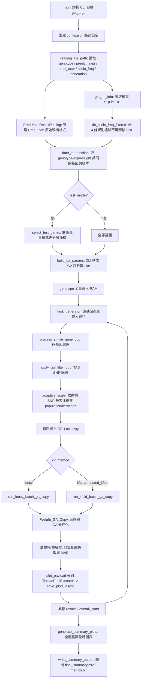
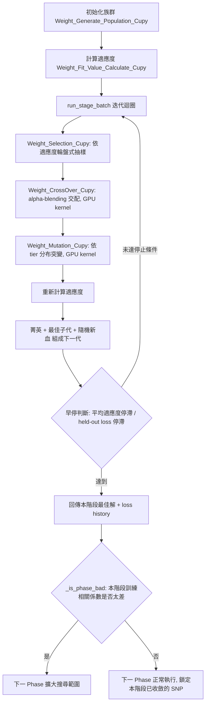

# GA.py 說明文件

## 1. 整體用途

`GA.py` 是一支以 **GPU (CuPy + Numba CUDA)** 平行化的**遺傳演算法 (Genetic Algorithm, GA)** 程式，用途是校正 **PrediXcan** 基因表現預測模型的權重，讓原本以歐洲人 (EUR) 族群訓練出來的權重，能更準確地轉移(transfer)到東亞人 (EAS) 族群上使用。

背景問題：PrediXcan 這類基因表現預測模型的權重是根據 EUR 族群的 GWAS/eQTL 資料訓練出來的。當直接套用到 EAS 族群時，因為兩個族群之間的 **等位基因頻率 (Allele Frequency, AF)** 與 **連鎖不平衡 (LD)** 結構不同，預測準確度會下降，尤其是 AF 差異越大的 SNP，權重越不可信。

`GA.py` 的解法：
1. 用每個 SNP 的 EUR/EAS AF 差異，把 SNP 分成 **S/M/L 三個 tier**（差異小/中/大）。
2. 用 GA 分三個 Phase，針對每個 tier 搜尋一個「縮放係數 (scaling factor)」，乘在原始 PrediXcan 權重上，讓調整後的預測值與 EAS 族群真實表現量的相關係數最大化。
3. 用 LOOCV 或 K-Fold 交叉驗證確保結果不是過擬合(overfitting)。
4. 額外用 **TAS (Transferability-Adjusted Score)** filter，在跑 GA 之前先篩掉最不可轉移的 SNP。
5. 對每個基因、以及整批基因，輸出統計表格與圖表，比較「校正前 (PrediXcan)」vs「校正後 (GA)」的表現。

---

## 2. 高階流程圖



---

## 3. GA 三階段最佳化內部流程（`Weight_GA_Cupy`）

SNP 依照 AF 差異被分成三個 tier，GA 分三個 Phase 依序（或視前一階段結果不佳而擴大範圍）最佳化：

- **Phase 1**：L-tier（AF 差異最大、最不可靠的 SNP）
- **Phase 2**：M-tier（中等 AF 差異），並「暖啟動 (warm-start)」繼承 Phase 1 的解
- **Phase 3**：S-tier（AF 差異最小、最可信），繼承 Phase 1+2 的解做微調

若某個 Phase 算出來的「訓練相關係數」太差（用 Fisher-z 信賴區間判斷），下一個 Phase 會自動擴大搜尋範圍（例如 Phase2 同時重搜 L+M tier，甚至 Phase3 重搜全部 tier），這是一種失敗回退（fallback）機制。



**適應度 (Fitness) 公式**：損失 = `-arctanh(correlation)`（Fisher z 轉換），加上一個很小的「族群多樣性懲罰項」（entropy evenness penalty），讓 loss 隨相關係數平滑且無截斷地遞減，相關係數越接近 +1 loss 越小（越好）。

---

## 4. 各函式群組說明

### 4.1 參數與資料讀取

| 函式 | 功能 |
|---|---|
| `get_args()` | 定義並解析所有命令列參數（GA 超參數、tier 邊界、TAS 篩選參數、CV 方法等）。詳細參數表見 4.1.1。 |
| `reading_file_path(config)` | 讀取 `config.json` 指定路徑的 genotype (parquet, dask)、predict/real expression (csv/tsv)、allele_freq、annotation、DB 路徑。 |
| `PrediXcanResultDealing(expr_df)` | 把 PrediXcan 原始輸出（樣本為列、基因為欄）轉置成（基因為列、樣本為欄），並整理 Ensembl ID。 |
| `get_db_info(db_path)` | 從 SQLite DB 讀出 `weights`（gene/rsid/weight）與 `extra`（基因中繼資料）兩張表。 |
| `db_allele_freq_filtered(...)` | 合併 weight 與 allele_freq，依 4 條規則濾除不可轉移的 SNP（EAS AF < 0.01、`|weight|` 太小、EUR MAF 太低、EUR→EAS AF 差距過大）。 |
| `data_intersection(...)` | 取 predict_expr / real_expr / weight table 三者共同的基因與樣本，對齊資料。 |

### 4.1.1 `get_args()` 參數詳解

以下依 `GA.py` 原始碼中 `parser.add_argument` 出現的順序整理，涵蓋所有 CLI 參數。

**General GA Parameters（GA 基本超參數）**

| 參數 | 型別 | 預設值 | 說明 |
|---|---|---|---|
| `--config` | str | `config.json` | JSON 設定檔路徑，內含 `genotype_path`/`predict_expr_path`/`real_expr_path`/`allele_freq_path`/`annotation_path`/`db_path`/`out_dir` 七個欄位。 |
| `--GA_Phase1_iterations` | int | `500` | GA Phase 1（L-tier，AF 差異最大）最大迭代（世代）數。 |
| `--GA_Phase2_iterations` | int | `750` | GA Phase 2（M-tier）最大迭代數。 |
| `--GA_Phase3_iterations` | int | `250` | GA Phase 3（S-tier，微調）最大迭代數。 |
| `--GA_population_sizes` | int | `500` | 每個 batch 的族群個體數（population size）。 |
| `--Numbers_of_GA_runs` | int | `50` | 每個 fold 要重複跑幾次 GA（取平均，降低隨機性造成的變異）。 |
| `--Initial_mutation_rate` | float | `0.5` | GA 起始突變率，會在每個 Phase 內線性退火到 0.2。 |

**GA Weighting Parameters（Tier 縮放範圍）**

| 參數 | 型別 | 預設值 | 說明 |
|---|---|---|---|
| `--s_tier_af_diff_max` | float | `0.05` | S-tier 的最大 AF 差異門檻；內部會換算成 `s_tier_threshold = 1 - 此值`。 |
| `--s_tier_low_bound` | float | `0.9` | S-tier 縮放係數抽樣下界。 |
| `--s_tier_high_bound` | float | `1.1` | S-tier 縮放係數抽樣上界。 |
| `--m_tier_af_diff_max` | float | `0.25` | M-tier 的最大 AF 差異門檻；換算成 `m_tier_threshold = 1 - 此值`。 |
| `--m_tier_low_bound` | float | `0.5` | M-tier 雙峰分布下段區間下界。 |
| `--m_tier_high_bound` | float | `3.0` | M-tier 雙峰分布上段區間上界。 |
| `--l_tier_low_bound` | float | `0.1` | L-tier 雙峰分布下段區間下界。 |
| `--l_tier_high_bound` | float | `5.0` | L-tier 雙峰分布上段區間上界。 |
| `--pruning_threshold` | float | `1e-8` | GA 結束後的硬剪枝門檻：`\|w_start * a_vec * avg_scaling\|` 低於此值強制歸零。 |

**Sign-Flip 與適應度相關（V3 新增）**

| 參數 | 型別 | 預設值 | 說明 |
|---|---|---|---|
| `--allow_sign_flip` | flag (store_true) | `False` | 允許 M/L-tier 縮放係數取負值（可翻轉預測方向）；S-tier 恆為正。 |
| `--sign_flip_threshold` | float | `0.01` | 當某基因的 baseline 相關係數低於此值時才嘗試 sign-flip 搜尋。 |

**TAS（Transferability-Adjusted Score）篩選參數**

| 參數 | 型別 | 預設值 | 說明 |
|---|---|---|---|
| `--tas_decay_scale` | float | `0.20` | TAS 分數中「可轉移性衰減」的 decay scale。 |
| `--tas_keep_frac_ml` | float | `0.8` | M/L-tier 依 TAS 分數保留的比例（由高到低取前 80%）。 |
| `--tas_min_snps_to_filter` | int | `5` | 該基因 SNP 總數低於此值則不做 TAS 篩選（樣本太少篩選無意義）。 |
| `--adaptive_scale` / `--no-adaptive_scale` | bool (`BooleanOptionalAction`) | `True` | 是否依 TAS 篩選後剩餘 SNP 數等比例縮放 population/iterations。 |
| `--adaptive_ref_snps` | int | `20` | Adaptive scaling 的參考 SNP 數；達到此數量時使用完整（未縮放）設定。 |
| `--min_population` | int | `300` | Adaptive scaling 後 population size 的下限。 |
| `--min_iter1` | int | `200` | Adaptive scaling 後 Phase 1 迭代數下限。 |
| `--min_iter2` | int | `300` | Adaptive scaling 後 Phase 2 迭代數下限。 |
| `--min_iter3` | int | `100` | Adaptive scaling 後 Phase 3 迭代數下限。 |

**GPU Batch Control**

| 參數 | 型別 | 預設值 | 說明 |
|---|---|---|---|
| `--batch_limit` | int | `2048` | 單次送進 GPU 的最大平行 GA 任務數（fold × run），避免記憶體爆掉。 |
| `--plot_thread` | int | `4` | `ThreadPoolExecutor` 背景繪圖執行緒數，不阻塞主流程 GPU 運算。 |

**Test Mode（快速測試用）**

| 參數 | 型別 | 預設值 | 說明 |
|---|---|---|---|
| `--test_mode` | flag (store_true) | `False` | 開啟後只跑抽樣出的部分基因（用於快速驗證流程，不需跑全部基因）。 |
| `--test_count` | int | `50` | `test_mode` 下要抽樣的基因數量。 |
| `--test_seed` | int | `42` | `select_test_genes` 分層抽樣用的隨機種子。 |

**Cross-Validation Parameters**

| 參數 | 型別 | 預設值 | 說明 |
|---|---|---|---|
| `--cv_method` | str（choices: `loocv`, `repeated_kfold`） | `loocv` | 交叉驗證策略；注意 choices 只有這兩個值（沒有純 `kfold` 選項，`n_repeats=1` 時 `repeated_kfold` 即等同一般 K-Fold）。 |
| `--n_splits` | int | `5` | K-Fold 的 K（`cv_method=repeated_kfold` 時使用）。 |
| `--n_repeats` | int | `3` | RepeatedKFold 重複次數。 |
| `--cv_seed` | int | `42` | 切分 fold 用的隨機種子。 |

---

### 4.2 族群初始化與突變（GPU）

| 函式 | 功能 |
|---|---|
| `Weight_Generate_Population_Cupy(...)` | 初始化 GA 族群，每個個體是一組每 SNP 的「縮放係數」。S-tier 固定正值範圍；M/L-tier 用雙峰分布（bimodal，避開中間 1.0 附近的區間，因為那代表「幾乎不調整」，不需要浪費搜尋空間）；若開啟 `allow_sign_flip`，M/L-tier 額外允許負值（代表方向翻轉）。 |
| `crossover_kernel` / `Weight_CrossOver_Cupy` | CUDA kernel + wrapper，用隨機配對 + alpha-blending（線性內插）產生子代。 |
| `mutation_kernel` / `Weight_Mutation_Cupy` | CUDA kernel + wrapper，依 SNP 所屬 tier，用不同的均勻/雙峰分布重新抽樣突變值；`allow_sign_flip` 開啟時 M/L-tier 突變會分 4 象限（正負各半）。 |
| `Weight_Selection_Cupy(population)` | 用「適應度倒數平方 + 隨機噪音」做輪盤式抽樣，選出親代進入交配。 |

### 4.3 適應度計算

| 函式 | 功能 |
|---|---|
| `Weight_Fit_Value_Calculate_Cupy(...)` | 計算每個個體的預測值與真實表現量的相關係數，轉成 Fisher-z loss，加上族群多樣性懲罰，支援訓練/測試 mask（用於交叉驗證）。 |

### 4.4 GA 主流程與早停

| 函式 | 功能 |
|---|---|
| `_is_phase_bad(corr_val, n_samples, bad_thresh)` | 用 Fisher-z 信賴區間判斷某 Phase 的訓練相關係數是否「差到需要下一 Phase 擴大搜尋範圍」。 |
| `Weight_GA_Cupy(backend, rsid_all, num_batches, **kwargs)` | GA 主體：執行三階段最佳化，內含 `run_stage_batch`（單一階段的世代迴圈，含早停判斷）與 `_compute_train_corr`（計算當前最佳解的訓練相關係數）。 |

### 4.5 交叉驗證

| 函式 | 功能 |
|---|---|
| `run_loocv_batch_ga_cupy(...)` | Leave-One-Out 交叉驗證：每個樣本輪流當測試集，其餘樣本正規化後跑 GA，彙整每 fold 多次 run 的平均權重，計算 out-of-fold 預測與穩定性(std)。 |
| `run_kfold_batch_ga_cupy(...)` | K-Fold / Repeated K-Fold 版本，邏輯與 LOOCV 相同但一次留出多個樣本；Repeated K-Fold 時同一樣本會出現在多個 fold 的測試集，最後對多次結果取平均。 |

兩者都會把「所有 fold × 所有 run」的任務一次建構好，再依 `batch_limit` 切成多個 chunk 送進 GPU，減少呼叫 `Weight_GA_Cupy` 的次數、提高 GPU 平行效率。

### 4.6 TAS SNP 篩選

| 函式 | 功能 |
|---|---|
| `apply_tas_filter_cpu(...)` | 在送上 GPU 之前，於 CPU 端先篩選 SNP：SNP 總數太少（< `min_snps_to_filter`）則不篩；S-tier 全部保留；M+L-tier 依 **TAS 分數 = 權重百分位排名 × exp(-超出量/decay_scale)** 由高到低取前 `keep_frac_ml` 比例保留。TAS 分數同時考慮「權重大小(重要性)」與「可轉移性(AF 差異衰減)」。 |

### 4.7 單基因處理主流程

| 函式 | 功能 |
|---|---|
| `process_single_gene_gpu(...)` | 單一基因的完整處理：對齊 genotype/expression → 計算校正前(PrediXcan)相關係數 → 依此動態調整 GA runs 數與是否啟用 sign-flip → TAS 篩選 → adaptive scale → 搬上 GPU → 跑 LOOCV/K-Fold GA → 彙整權重(依 `allow_sign_flip` 選擇 `_aggregate_and_prune_weights` 或 `_aggregate_weights_with_vote`) → 輸出 CSV → 打包結果與繪圖 payload。 |
| `_build_gene_result(...)` | 把單一基因的所有指標打包成一個 dict，供主程式彙總。 |
| `_aggregate_and_prune_weights(...)` | 非 sign-flip 模式：用 IQR-robust 平均（排除離群 fold）彙整各 fold 的縮放係數，並剪枝過小的最終權重。 |
| `_aggregate_weights_with_vote(...)` | sign-flip 模式：因為各 fold 可能選到不同方向，先用多數決決定每個 SNP 的方向，對齊方向後再平均；投票太不一致的 SNP 直接歸零。 |

### 4.8 任務產生器與批次抽樣

| 函式 | 功能 |
|---|---|
| `task_generator(...)` | 逐一 yield 每個基因所需的輸入資料組合，準備給 `process_single_gene_gpu`。 |
| `select_test_genes(...)` | `--test_mode` 用：依基因表現量標準差分層抽樣一部分基因，用最大餘數法讓各層抽樣數量與該層基因數成比例，方便快速測試。 |

### 4.9 彙總輸出與繪圖

| 函式 | 功能 |
|---|---|
| `build_ga_params(args)` | 把 CLI 參數轉成貫穿全程式的 GA 超參數 dict。 |
| `save_plots_async(payload)` | 每個基因產出 4 張圖：loss 收斂曲線、Z-score 分布比較、相關係數散佈圖、逐樣本折線圖；在 ThreadPoolExecutor 背景執行緒跑，不阻塞下一個基因的 GPU 運算。 |
| `_plot_overfitting_diagnostic(ax, df, cv_tag, annotate)` | 畫「過擬合診斷」四象限散佈圖：X 軸是 train_corr 與驗證相關係數的差距(gap)，Y 軸是 fold 間訓練相關係數的標準差(不穩定度)，顏色代表驗證表現。 |
| `generate_summary_plots(...)` | 產生全體基因的彙總圖：MAE 改善分布圖、2×2 相關係數比較（訓練/驗證 × 散佈圖/長條圖，含 Fisher exact test + 多重比較校正的顯著性標記）、過擬合診斷圖。 |
| `write_summary_output(...)` | 輸出執行統計文字檔與 `final_summary.csv`（依 Improvement 排序）。 |
| `main()` | 整個程式的進入點，串接以上所有步驟；支援 `KeyboardInterrupt` 中斷後仍保留已完成的結果並輸出彙總。 |

---

## 5. 如何執行

```powershell
python GA.py `
    --config config.json `
    --cv_method loocv `
    --GA_Phase1_iterations 500 `
    --GA_Phase2_iterations 750 `
    --GA_Phase3_iterations 250 `
    --GA_population_sizes 500 `
    --Numbers_of_GA_runs 50 `
    --s_tier_af_diff_max 0.05 `
    --m_tier_af_diff_max 0.25 `
    --tas_keep_frac_ml 0.8 `
    --adaptive_scale `
    --batch_limit 2048
```

- `config.json` 需包含 `genotype_path`、`predict_expr_path`、`real_expr_path`、`allele_freq_path`、`annotation_path`、`db_path`、`out_dir` 七個路徑欄位。
- 測試少量基因：加上 `--test_mode --test_count 50`。
- 若要啟用方向翻轉搜尋（適合基線相關係數很差的基因）：加上 `--allow_sign_flip --sign_flip_threshold 0.01`。
- 切換成 (Repeated) K-Fold：`--cv_method kfold --n_splits 5` 或 `--cv_method repeated_kfold --n_splits 5 --n_repeats 3`。

輸出會在 `out_dir` 下，每個基因一個資料夾（含權重、fold 診斷、loss history、4 張圖），外加整批彙總的 `final_summary.csv`、`overall_performance_metrics.txt` 與多張彙總圖。

---

## 6. 批次執行腳本 `GA_pipeline.sh`

`GA_pipeline.sh` 是正式執行 `GA.py` 的批次腳本，把「LOOCV / 10-Fold / 3-Fold」×「Sign（`--allow_sign_flip`）/ Unsign」共 6 種組合都定義成 job，並用開關變數控制要跑哪幾個。

> **重要原則：平常只需要跑 LOOCV（Sign + Unsign）就好。** 10-Fold 與 3-Fold 只有在需要「比較不同 CV 方法穩定度/差異」時才需要開啟，不要每次都全部跑，會浪費大量 GPU 時間。腳本預設已經把 `RUN_10FOLD_*`、`RUN_3FOLD_*` 設為 `false`。

### 6.1 結構說明

```bash
RUN_LOOCV_SIGN=true      # 一般情況下只需要開這兩個
RUN_LOOCV_UNSIGN=true
RUN_10FOLD_SIGN=false    # 只有要比較 CV 方法差異時才開
RUN_10FOLD_UNSIGN=false
RUN_3FOLD_SIGN=false     # 只有要比較 CV 方法差異時才開
RUN_3FOLD_UNSIGN=false

SEQUENTIAL=true          # 同一張 GPU 建議保持 true，逐一跑完再跑下一個
```
- 六個 `RUN_*` 開關對應六種 job，`true` 才會被執行；平常只留 `RUN_LOOCV_SIGN`/`RUN_LOOCV_UNSIGN` 為 `true` 即可。
- `SEQUENTIAL=true`（預設）：每個 job 用 `nohup ... &` 背景啟動後立刻 `wait`，等它跑完才啟動下一個，避免多個 job 搶同一張 GPU 的記憶體（`GA.py` 目前把 `CUDA_VISIBLE_DEVICES` 寫死為 `"1"`，所有 job 實際上都在同一張卡上跑）。若你確定 GPU 記憶體足夠、想要多個 job 同時背景執行（行為對應你原本手動貼上多段 `nohup ... &` 的用法），可把 `SEQUENTIAL` 改成 `false`；此模式下腳本會先把所有選中的 job 一次性背景啟動，最後再統一 `wait` 並回報成功/失敗。

```bash
SCRIPT="/mnt/data_80T/anywaycheng/GA/GA.py"
CONFIG="/mnt/data_80T/anywaycheng/GA/config.json"
OUT_BASE="/mnt/data_80T/anywaycheng/GA/5%_Result"
```
- `SCRIPT`/`CONFIG`/`OUT_BASE` 對應你原本 6 段 `nohup` 指令中共用的路徑，換機器/換資料時只需改這三行。每個 job 的輸出目錄與 log 會自動組成 `${OUT_BASE}/<job名稱>/ga_run_optimized.log`（例如 `V4_LOOCV_Sign`、`V4_10Fold_Unsign`），與你原本的目錄命名一致。

- `COMMON_PARAMS`：六個 job 完全共用的參數，對應你提供的 6 段指令中「每一段都一樣」的部分：`--GA_Phase1/2/3_iterations 500/750/250`、`--GA_population_sizes 1500`、`--Numbers_of_GA_runs 50`、`--Initial_mutation_rate 0.5`、`--pruning_threshold 1e-8`、`--s_tier_af_diff_max 0.05`、`--s_tier_low/high_bound 0.9/1.1`、`--m_tier_af_diff_max 0.25`、`--m_tier_low_bound 0.5`、`--l_tier_low/high_bound 0.0/0.5`、`--adaptive_scale --adaptive_ref_snps 20`、`--tas_keep_frac_ml 0.8 --tas_min_snps_to_filter 5`、`--cv_seed 42`、`--plot_thread 8`。
- `M_TIER_HIGH_DEFAULT=3.0` / `M_TIER_HIGH_3FOLD_SIGN=2.0`：`--m_tier_high_bound` 在 5 個 job 都是 `3.0`，只有 **3Fold (Sign)** 這個 job 原本是 `2.0`（沿用你提供的原始設定，是否為刻意調整已不可考，若要統一請直接修改這兩個變數）。
- `BATCH_LIMIT_DEFAULT=6400` / `BATCH_LIMIT_3FOLD_UNSIGN=12800`：`--batch_limit` 在 5 個 job 都是 `6400`，只有 **3Fold (Unsign)** 原本是 `12800`（同樣沿用原始設定）。
- `run_job(label, out_subdir, extra_params...)`：共用的執行函式，會自動組出 `python "$SCRIPT" "${COMMON_PARAMS[@]}" "${extra[@]}" > "$log" 2>&1 &`（並用 `nohup` 包住），依 `SEQUENTIAL` 決定要不要立刻 `wait`；`extra_params` 帶的是各 job 專屬的 `--m_tier_high_bound`、`--allow_sign_flip`（Sign 版才有）、`--cv_method`/`--n_splits`/`--n_repeats`、`--batch_limit`。
- 六個 job 對照表：

| Job | 對應開關 | `--cv_method` | `--allow_sign_flip` | `--m_tier_high_bound` | `--batch_limit` |
|---|---|---|---|---|---|
| V4 LOOCV (Sign) | `RUN_LOOCV_SIGN` | `loocv` | 是（`sign_flip_threshold 0.1`） | 3.0 | 6400 |
| V4 LOOCV (Unsign) | `RUN_LOOCV_UNSIGN` | `loocv` | 否 | 3.0 | 6400 |
| V4 10Fold (Sign) | `RUN_10FOLD_SIGN` | `repeated_kfold`，`n_splits=10 n_repeats=5` | 是 | 3.0 | 6400 |
| V4 10Fold (Unsign) | `RUN_10FOLD_UNSIGN` | `repeated_kfold`，`n_splits=10 n_repeats=5` | 否 | 3.0 | 6400 |
| V4 3Fold (Sign) | `RUN_3FOLD_SIGN` | `repeated_kfold`，`n_splits=3 n_repeats=5` | 是 | **2.0** | 6400 |
| V4 3Fold (Unsign) | `RUN_3FOLD_UNSIGN` | `repeated_kfold`，`n_splits=3 n_repeats=5` | 否 | 3.0 | **12800** |

- 任何一個 job 失敗（exit code 非 0）會被記錄到 `FAILED` 陣列，全部跑完後統一印出成功/失敗總結，若有失敗則以 exit code 1 結束。

### 6.2 使用方式

**一般情況（只跑 LOOCV）：** 不需要改任何東西，直接執行即可（預設就只跑 LOOCV Sign + Unsign 兩個 job）：

```bash
chmod +x GA_pipeline.sh
./GA_pipeline.sh
```

**要跑比較（例如同時比較 LOOCV / 10-Fold / 3-Fold）：** 打開 `GA_pipeline.sh`，把對應的 `RUN_10FOLD_*`、`RUN_3FOLD_*` 改成 `true` 後再執行。

因為腳本內部用 `nohup` 背景執行，就算 SSH 斷線 job 也會繼續跑；若想在背景長時間執行整支 pipeline（例如透過遠端連線啟動、之後登出），可以在最外層再包一層 `nohup`：

```bash
nohup ./GA_pipeline.sh > pipeline.log 2>&1 &
```

### 6.3 常見調整方式

| 需求 | 怎麼改 |
|---|---|
| 只跑 LOOCV（預設，日常使用） | 不用改，保持 `RUN_LOOCV_SIGN=true RUN_LOOCV_UNSIGN=true`，其餘四個維持 `false`。 |
| 要跑比較（CV 方法差異） | 把需要比較的 `RUN_10FOLD_*` / `RUN_3FOLD_*` 改成 `true`。 |
| 換資料集/路徑 | 改最上面的 `SCRIPT`、`CONFIG`、`OUT_BASE`。 |
| 調整 population/迭代數 | 改 `COMMON_PARAMS` 裡的 `--GA_Phase1/2/3_iterations`、`--GA_population_sizes`、`--Numbers_of_GA_runs`。 |
| 調整 tier 邊界 | 改 `COMMON_PARAMS` 裡的 `--s_tier_*`、`--m_tier_*`、`--l_tier_*`，或個別 job 的 `M_TIER_HIGH_*` 變數。 |
| GPU 記憶體不足 | 調低 `BATCH_LIMIT_DEFAULT`（目前 `6400`）/ `BATCH_LIMIT_3FOLD_UNSIGN`（目前 `12800`），與/或 `--GA_population_sizes`。 |
| 想讓多個 job 同時背景執行（不逐一等待） | 把 `SEQUENTIAL` 改成 `false`；但需注意 `GA.py` 目前 `CUDA_VISIBLE_DEVICES` 寫死為 `"1"`，多個 job 會搶同一張 GPU，記憶體不足時建議仍維持 `SEQUENTIAL=true`。 |
| 想調整 sign-flip 門檻 | 改各 Sign job 呼叫 `run_job` 時的 `--sign_flip_threshold`（目前統一是 `0.1`）。 |

執行紀錄會分別寫到 `${BASE}/v2_LOOCV/v2_loocv.log`、`${BASE}/v2_kfold/v2_kfold.log`、`${BASE}/v3_LOOCV/v3_loocv.log`、`${BASE}/v3_kfold/v3_kfold.log`，可用來個別排查失敗原因。