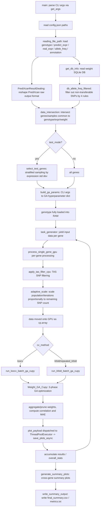
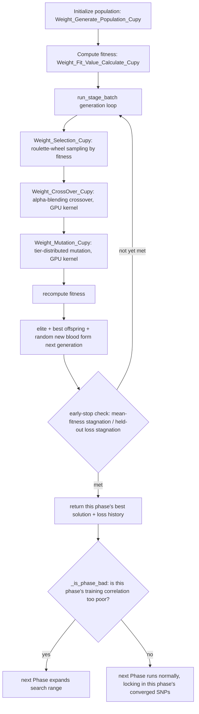

# GA.py Documentation

## 1. Overall Purpose

`GA.py` is a **GPU-parallelized (CuPy + Numba CUDA)** **Genetic Algorithm (GA)** program used to calibrate the weights of **PrediXcan** gene-expression prediction models, so that weights originally trained on a European (EUR) population transfer more accurately to an East Asian (EAS) population.

Background problem: PrediXcan-style gene expression prediction models are trained on EUR-population GWAS/eQTL data. When applied directly to an EAS population, prediction accuracy degrades because of differences in **Allele Frequency (AF)** and **Linkage Disequilibrium (LD)** structure between the two populations — the larger the AF difference for a given SNP, the less trustworthy its weight becomes.

`GA.py`'s solution:
1. Classify each SNP into one of **three tiers, S/M/L** (small/medium/large), based on the EUR/EAS AF difference.
2. Run a **3-phase GA**, searching for a "scaling factor" for each tier and multiplying it onto the original PrediXcan weight, so as to maximize the correlation between the adjusted prediction and the real EAS expression values.
3. Use LOOCV or K-Fold cross-validation to ensure the result isn't overfitting.
4. Additionally apply a **TAS (Transferability-Adjusted Score)** filter to remove the least transferable SNPs before running GA.
5. For each gene, and for the whole batch of genes, output statistical tables and plots comparing performance "before calibration (PrediXcan)" vs. "after calibration (GA)".

---

## 2. High-Level Flowchart



---

## 3. Internal Flow of the 3-Phase GA Optimization (`Weight_GA_Cupy`)

SNPs are split into three tiers by AF difference, and GA optimizes them across three Phases in sequence (or with an expanded search range if the previous phase performed poorly):

- **Phase 1**: L-tier (largest AF difference, least reliable SNPs)
- **Phase 2**: M-tier (medium AF difference), "warm-started" by inheriting Phase 1's solution
- **Phase 3**: S-tier (smallest AF difference, most reliable), inherits and fine-tunes the Phase 1+2 solution

If a Phase's resulting "training correlation" is too poor (judged via a Fisher-z confidence interval), the next Phase automatically expands its search range (e.g. Phase 2 re-searches L+M tiers together, or Phase 3 even re-searches all tiers) — this is a failure-fallback mechanism.



**Fitness formula**: loss = `-arctanh(correlation)` (Fisher-z transform), plus a small "population diversity penalty" (entropy evenness penalty), so that loss decreases smoothly and without truncation as correlation rises — the closer correlation is to +1, the lower (better) the loss.

---

## 4. Function-Group Reference

### 4.1 Argument Parsing & Data Loading

| Function | Purpose |
|---|---|
| `get_args()` | Defines and parses all CLI arguments (GA hyperparameters, tier boundaries, TAS filter parameters, CV method, etc). Full parameter table in 4.1.1. |
| `reading_file_path(config)` | Reads genotype (parquet, dask), predict/real expression (csv/tsv), allele_freq, annotation, and DB paths from `config.json`. |
| `PrediXcanResultDealing(expr_df)` | Transposes PrediXcan raw output (rows = samples, columns = genes) into (rows = genes, columns = samples), and cleans up Ensembl IDs. |
| `get_db_info(db_path)` | Reads the `weights` (gene/rsid/weight) and `extra` (gene metadata) tables from the SQLite DB. |
| `db_allele_freq_filtered(...)` | Merges weight and allele_freq tables, filtering out non-transferable SNPs via 4 rules (EAS AF < 0.01, `\|weight\|` too small, EUR MAF too low, EUR→EAS AF gap too large). |
| `data_intersection(...)` | Intersects genes and samples common to predict_expr / real_expr / weight table, and aligns the data. |

### 4.1.1 `get_args()` Parameter Reference

Organized in the order `parser.add_argument` calls appear in `GA.py`'s source, covering all CLI arguments.

**General GA Parameters**

| Argument | Type | Default | Description |
|---|---|---|---|
| `--config` | str | `config.json` | Path to JSON config file, containing the 7 fields `genotype_path`/`predict_expr_path`/`real_expr_path`/`allele_freq_path`/`annotation_path`/`db_path`/`out_dir`. |
| `--GA_Phase1_iterations` | int | `500` | Max iterations (generations) for GA Phase 1 (L-tier, largest AF difference). |
| `--GA_Phase2_iterations` | int | `750` | Max iterations for GA Phase 2 (M-tier). |
| `--GA_Phase3_iterations` | int | `250` | Max iterations for GA Phase 3 (S-tier, fine-tuning). |
| `--GA_population_sizes` | int | `500` | Population size (individuals) per batch. |
| `--Numbers_of_GA_runs` | int | `50` | Number of GA repeats per fold (averaged, to reduce variance from randomness). |
| `--Initial_mutation_rate` | float | `0.5` | Initial GA mutation rate, linearly annealed to 0.2 within each Phase. |

**GA Weighting Parameters (Tier Scaling Ranges)**

| Argument | Type | Default | Description |
|---|---|---|---|
| `--s_tier_af_diff_max` | float | `0.05` | Max AF-difference threshold for S-tier; internally converted to `s_tier_threshold = 1 - this value`. |
| `--s_tier_low_bound` | float | `0.9` | Lower bound of S-tier scaling-factor sampling range. |
| `--s_tier_high_bound` | float | `1.1` | Upper bound of S-tier scaling-factor sampling range. |
| `--m_tier_af_diff_max` | float | `0.25` | Max AF-difference threshold for M-tier; converted to `m_tier_threshold = 1 - this value`. |
| `--m_tier_low_bound` | float | `0.5` | Lower bound of the M-tier bimodal distribution's lower interval. |
| `--m_tier_high_bound` | float | `3.0` | Upper bound of the M-tier bimodal distribution's upper interval. |
| `--l_tier_low_bound` | float | `0.1` | Lower bound of the L-tier bimodal distribution's lower interval. |
| `--l_tier_high_bound` | float | `5.0` | Upper bound of the L-tier bimodal distribution's upper interval. |
| `--pruning_threshold` | float | `1e-8` | Hard-pruning threshold applied after GA finishes: `\|w_start * a_vec * avg_scaling\|` below this value is forced to zero. |

**Sign-Flip & Fitness-Related (added in V3)**

| Argument | Type | Default | Description |
|---|---|---|---|
| `--allow_sign_flip` | flag (store_true) | `False` | Allow M/L-tier scaling factors to take negative values (can flip prediction direction); S-tier is always positive. |
| `--sign_flip_threshold` | float | `0.01` | Only attempt sign-flip search for a gene when its baseline correlation is below this threshold. |

**TAS (Transferability-Adjusted Score) Filtering Parameters**

| Argument | Type | Default | Description |
|---|---|---|---|
| `--tas_decay_scale` | float | `0.20` | Decay scale for the "transferability decay" component of the TAS score. |
| `--tas_keep_frac_ml` | float | `0.8` | Fraction of M/L-tier SNPs kept by TAS score (top 80% by score are retained). |
| `--tas_min_snps_to_filter` | int | `5` | If a gene's total SNP count is below this value, TAS filtering is skipped (filtering is meaningless with too few SNPs). |
| `--adaptive_scale` / `--no-adaptive_scale` | bool (`BooleanOptionalAction`) | `True` | Whether to scale population/iterations proportionally to the SNP count remaining after TAS filtering. |
| `--adaptive_ref_snps` | int | `20` | Reference SNP count for adaptive scaling; full (unscaled) settings are used once this count is reached. |
| `--min_population` | int | `300` | Lower bound on population size after adaptive scaling. |
| `--min_iter1` | int | `200` | Lower bound on Phase 1 iteration count after adaptive scaling. |
| `--min_iter2` | int | `300` | Lower bound on Phase 2 iteration count after adaptive scaling. |
| `--min_iter3` | int | `100` | Lower bound on Phase 3 iteration count after adaptive scaling. |

**GPU Batch Control**

| Argument | Type | Default | Description |
|---|---|---|---|
| `--batch_limit` | int | `2048` | Max number of parallel GA tasks (fold × run) sent to GPU in one batch, to avoid running out of memory. |
| `--plot_thread` | int | `4` | Number of background plotting threads (`ThreadPoolExecutor`); does not block the main GPU computation. |

**Test Mode (for quick testing)**

| Argument | Type | Default | Description |
|---|---|---|---|
| `--test_mode` | flag (store_true) | `False` | When enabled, only runs a sampled subset of genes (for quickly validating the pipeline without running all genes). |
| `--test_count` | int | `50` | Number of genes to sample under `test_mode`. |
| `--test_seed` | int | `42` | Random seed for `select_test_genes`'s stratified sampling. |

**Cross-Validation Parameters**

| Argument | Type | Default | Description |
|---|---|---|---|
| `--cv_method` | str (choices: `loocv`, `repeated_kfold`) | `loocv` | Cross-validation strategy; note that choices are limited to these two values (there is no plain `kfold` option — `repeated_kfold` with `n_repeats=1` is equivalent to ordinary K-Fold). |
| `--n_splits` | int | `5` | K in K-Fold (used when `cv_method=repeated_kfold`). |
| `--n_repeats` | int | `3` | Number of RepeatedKFold repetitions. |
| `--cv_seed` | int | `42` | Random seed used for fold splitting. |

---

### 4.2 Population Initialization & Mutation (GPU)

| Function | Purpose |
|---|---|
| `Weight_Generate_Population_Cupy(...)` | Initializes the GA population; each individual is a set of per-SNP "scaling factors". S-tier is fixed to a positive-value range; M/L-tier use a bimodal distribution (avoiding the interval around 1.0, since that represents "essentially no adjustment" and is not worth wasting search space on); if `allow_sign_flip` is enabled, M/L-tier additionally allow negative values (representing direction flip). |
| `crossover_kernel` / `Weight_CrossOver_Cupy` | CUDA kernel + wrapper; produces offspring via random pairing + alpha-blending (linear interpolation). |
| `mutation_kernel` / `Weight_Mutation_Cupy` | CUDA kernel + wrapper; resamples mutation values from different uniform/bimodal distributions depending on the SNP's tier; when `allow_sign_flip` is enabled, M/L-tier mutation is split into 4 quadrants (half positive, half negative). |
| `Weight_Selection_Cupy(population)` | Roulette-wheel sampling using "inverse-squared fitness + random noise" to select parents for crossover. |

### 4.3 Fitness Computation

| Function | Purpose |
|---|---|
| `Weight_Fit_Value_Calculate_Cupy(...)` | Computes each individual's correlation between predicted values and real expression, converts it to a Fisher-z loss, adds a population diversity penalty, and supports train/test masks (for cross-validation). |

### 4.4 GA Main Loop & Early Stopping

| Function | Purpose |
|---|---|
| `_is_phase_bad(corr_val, n_samples, bad_thresh)` | Uses a Fisher-z confidence interval to judge whether a Phase's training correlation is "poor enough that the next Phase needs to expand its search range". |
| `Weight_GA_Cupy(backend, rsid_all, num_batches, **kwargs)` | The GA core: runs the 3-phase optimization, including `run_stage_batch` (a single phase's generation loop, with early-stop checks) and `_compute_train_corr` (computing the training correlation of the current best solution). |

### 4.5 Cross-Validation

| Function | Purpose |
|---|---|
| `run_loocv_batch_ga_cupy(...)` | Leave-One-Out cross-validation: each sample takes a turn as the test set, GA is run on the normalized remaining samples, per-fold multi-run weights are averaged, and out-of-fold predictions and stability (std) are computed. |
| `run_kfold_batch_ga_cupy(...)` | K-Fold / Repeated K-Fold version, same logic as LOOCV but holding out multiple samples at once; under Repeated K-Fold the same sample can appear in multiple folds' test sets, and results are averaged at the end. |

Both build all "fold × run" tasks at once, then split them into GPU batches according to `batch_limit`, reducing the number of calls to `Weight_GA_Cupy` and improving GPU parallel efficiency.

### 4.6 TAS SNP Filtering

| Function | Purpose |
|---|---|
| `apply_tas_filter_cpu(...)` | Filters SNPs on the CPU before sending them to the GPU: skips filtering if the total SNP count is too low (< `min_snps_to_filter`); keeps all S-tier SNPs; for M+L-tier, keeps the top `keep_frac_ml` fraction ranked by **TAS score = weight percentile rank × exp(-excess/decay_scale)**. The TAS score jointly considers "weight magnitude (importance)" and "transferability (AF-difference decay)". |

### 4.7 Single-Gene Processing Main Flow

| Function | Purpose |
|---|---|
| `process_single_gene_gpu(...)` | Full processing for a single gene: align genotype/expression → compute pre-calibration (PrediXcan) correlation → dynamically adjust GA run count and whether sign-flip is enabled based on that → TAS filtering → adaptive scale → move to GPU → run LOOCV/K-Fold GA → aggregate weights (chooses `_aggregate_and_prune_weights` or `_aggregate_weights_with_vote` depending on `allow_sign_flip`) → write CSV → package results and plotting payload. |
| `_build_gene_result(...)` | Packages all metrics for a single gene into a dict for the main program to aggregate. |
| `_aggregate_and_prune_weights(...)` | Non-sign-flip mode: aggregates each fold's scaling factors via an IQR-robust average (excluding outlier folds), and prunes final weights that are too small. |
| `_aggregate_weights_with_vote(...)` | Sign-flip mode: since different folds may pick different directions, a majority vote first decides each SNP's direction, then averages after aligning direction; SNPs with too much voting disagreement are zeroed out directly. |

### 4.8 Task Generator & Batch Sampling

| Function | Purpose |
|---|---|
| `task_generator(...)` | Yields the input-data combination needed for each gene, one at a time, ready for `process_single_gene_gpu`. |
| `select_test_genes(...)` | Used by `--test_mode`: stratified sampling of a subset of genes by expression standard deviation, using the largest-remainder method so each stratum's sample count is proportional to its gene count, for convenient quick testing. |

### 4.9 Summary Output & Plotting

| Function | Purpose |
|---|---|
| `build_ga_params(args)` | Converts CLI arguments into the GA hyperparameter dict used throughout the program. |
| `save_plots_async(payload)` | Produces 4 plots per gene: loss convergence curve, Z-score distribution comparison, correlation scatter plot, per-sample line plot; runs in a `ThreadPoolExecutor` background thread so it doesn't block GPU computation for the next gene. |
| `_plot_overfitting_diagnostic(ax, df, cv_tag, annotate)` | Draws an "overfitting diagnostic" 4-quadrant scatter plot: X-axis is the gap between train_corr and validation correlation, Y-axis is the standard deviation of training correlation across folds (instability), color represents validation performance. |
| `generate_summary_plots(...)` | Produces cross-gene summary plots: MAE improvement distribution, a 2×2 correlation comparison (train/validation × scatter/bar, with significance markers from Fisher's exact test + multiple-comparison correction), and the overfitting diagnostic plot. |
| `write_summary_output(...)` | Writes run statistics text file and `final_summary.csv` (sorted by Improvement). |
| `main()` | The program's entry point; wires together all steps above; supports `KeyboardInterrupt` — results already completed are retained and summarized even after an interrupt. |

---

## 5. How to Run

```powershell
python GA.py `
    --config config.json `
    --cv_method loocv `
    --GA_Phase1_iterations 500 `
    --GA_Phase2_iterations 750 `
    --GA_Phase3_iterations 250 `
    --GA_population_sizes 500 `
    --Numbers_of_GA_runs 50 `
    --s_tier_af_diff_max 0.05 `
    --m_tier_af_diff_max 0.25 `
    --tas_keep_frac_ml 0.8 `
    --adaptive_scale `
    --batch_limit 2048
```

- `config.json` must contain the 7 path fields `genotype_path`, `predict_expr_path`, `real_expr_path`, `allele_freq_path`, `annotation_path`, `db_path`, `out_dir`.
- To test on a small number of genes: add `--test_mode --test_count 50`.
- To enable sign-flip search (useful for genes with very poor baseline correlation): add `--allow_sign_flip --sign_flip_threshold 0.01`.
- To switch to (Repeated) K-Fold: `--cv_method kfold --n_splits 5` or `--cv_method repeated_kfold --n_splits 5 --n_repeats 3`.

Output goes under `out_dir`, one folder per gene (containing weights, fold diagnostics, loss history, 4 plots), plus batch-level `final_summary.csv`, `overall_performance_metrics.txt`, and several summary plots.

---

## 6. Batch Runner Script `GA_pipeline.sh`

`GA_pipeline.sh` is the batch script for formally running `GA.py`. It defines 6 job combinations of "LOOCV / 10-Fold / 3-Fold" × "Sign (`--allow_sign_flip`) / Unsign", controlled by switch variables for which ones actually run.

> **Important principle: normally only LOOCV (Sign + Unsign) needs to run.** 10-Fold and 3-Fold are only needed when you specifically want to "compare stability/differences across CV methods" — don't run them every time, since that wastes a lot of GPU time. The script defaults `RUN_10FOLD_*` and `RUN_3FOLD_*` to `false`.

### 6.1 Structure

```bash
RUN_LOOCV_SIGN=true      # Normally only these two need to be on
RUN_LOOCV_UNSIGN=true
RUN_10FOLD_SIGN=false    # Only enable when comparing CV methods
RUN_10FOLD_UNSIGN=false
RUN_3FOLD_SIGN=false     # Only enable when comparing CV methods
RUN_3FOLD_UNSIGN=false

SEQUENTIAL=true          # Recommended true on a single GPU, run one job to completion before starting the next
```
- The six `RUN_*` switches correspond to six jobs; only those set `true` will run — normally leave just `RUN_LOOCV_SIGN`/`RUN_LOOCV_UNSIGN` as `true`.
- `SEQUENTIAL=true` (default): each job is launched in the background with `nohup ... &` and immediately `wait`ed on, so the next job doesn't start until the current one finishes — this avoids multiple jobs fighting over the same GPU's memory (`GA.py` currently hardcodes `CUDA_VISIBLE_DEVICES` to `"1"`, so all jobs actually run on the same card). If you're sure there's enough GPU memory and want multiple jobs running in the background simultaneously (equivalent to manually pasting several `nohup ... &` commands), set `SEQUENTIAL` to `false`; in this mode the script launches all selected jobs in the background at once, then does a single combined `wait` and reports overall success/failure.

```bash
SCRIPT="/mnt/data_80T/anywaycheng/GA/GA.py"
CONFIG="/mnt/data_80T/anywaycheng/GA/config.json"
OUT_BASE="/mnt/data_80T/anywaycheng/GA/5%_Result"
```
- `SCRIPT`/`CONFIG`/`OUT_BASE` correspond to the paths shared across your original 6 `nohup` commands — only these three lines need to change when switching machines/datasets. Each job's output directory and log are automatically composed as `${OUT_BASE}/<job_name>/ga_run_optimized.log` (e.g. `V4_LOOCV_Sign`, `V4_10Fold_Unsign`), matching your original directory naming.

- `COMMON_PARAMS`: parameters fully shared by all six jobs, corresponding to the parts that were identical across your original 6 command blocks: `--GA_Phase1/2/3_iterations 500/750/250`, `--GA_population_sizes 1500`, `--Numbers_of_GA_runs 50`, `--Initial_mutation_rate 0.5`, `--pruning_threshold 1e-8`, `--s_tier_af_diff_max 0.05`, `--s_tier_low/high_bound 0.9/1.1`, `--m_tier_af_diff_max 0.25`, `--m_tier_low_bound 0.5`, `--l_tier_low/high_bound 0.0/0.5`, `--adaptive_scale --adaptive_ref_snps 20`, `--tas_keep_frac_ml 0.8 --tas_min_snps_to_filter 5`, `--cv_seed 42`, `--plot_thread 8`.
- `M_TIER_HIGH_DEFAULT=3.0` / `M_TIER_HIGH_3FOLD_SIGN=2.0`: `--m_tier_high_bound` is `3.0` for 5 jobs; only **3Fold (Sign)** originally used `2.0` (carried over from your original settings — whether this was an intentional adjustment is no longer traceable; edit these two variables directly if you want to unify them).
- `BATCH_LIMIT_DEFAULT=6400` / `BATCH_LIMIT_3FOLD_UNSIGN=12800`: `--batch_limit` is `6400` for 5 jobs; only **3Fold (Unsign)** originally used `12800` (likewise carried over from the original settings).
- `run_job(label, out_subdir, extra_params...)`: shared execution function that automatically composes `python "$SCRIPT" "${COMMON_PARAMS[@]}" "${extra[@]}" > "$log" 2>&1 &` (wrapped in `nohup`), and decides whether to `wait` immediately based on `SEQUENTIAL`; `extra_params` carries each job's specific `--m_tier_high_bound`, `--allow_sign_flip` (Sign versions only), `--cv_method`/`--n_splits`/`--n_repeats`, and `--batch_limit`.
- The six-job reference table:

| Job | Controlling Switch | `--cv_method` | `--allow_sign_flip` | `--m_tier_high_bound` | `--batch_limit` |
|---|---|---|---|---|---|
| V4 LOOCV (Sign) | `RUN_LOOCV_SIGN` | `loocv` | yes (`sign_flip_threshold 0.1`) | 3.0 | 6400 |
| V4 LOOCV (Unsign) | `RUN_LOOCV_UNSIGN` | `loocv` | no | 3.0 | 6400 |
| V4 10Fold (Sign) | `RUN_10FOLD_SIGN` | `repeated_kfold`, `n_splits=10 n_repeats=5` | yes | 3.0 | 6400 |
| V4 10Fold (Unsign) | `RUN_10FOLD_UNSIGN` | `repeated_kfold`, `n_splits=10 n_repeats=5` | no | 3.0 | 6400 |
| V4 3Fold (Sign) | `RUN_3FOLD_SIGN` | `repeated_kfold`, `n_splits=3 n_repeats=5` | yes | **2.0** | 6400 |
| V4 3Fold (Unsign) | `RUN_3FOLD_UNSIGN` | `repeated_kfold`, `n_splits=3 n_repeats=5` | no | 3.0 | **12800** |

- Any job that fails (non-zero exit code) is recorded in the `FAILED` array; once all jobs finish, a combined success/failure summary is printed, and the script exits with code 1 if there were any failures.

### 6.2 Usage

**Normal case (LOOCV only):** No changes needed — just run it (by default only the LOOCV Sign + Unsign jobs run):

```bash
chmod +x GA_pipeline.sh
./GA_pipeline.sh
```

**To run comparisons (e.g. LOOCV / 10-Fold / 3-Fold together):** Open `GA_pipeline.sh`, set the corresponding `RUN_10FOLD_*` / `RUN_3FOLD_*` to `true`, then run.

Since the script runs jobs in the background via `nohup`, jobs keep running even if the SSH connection drops; if you want to run the entire pipeline in the background for a long time (e.g. launched over a remote connection, then logging out), you can wrap another layer of `nohup` around it:

```bash
nohup ./GA_pipeline.sh > pipeline.log 2>&1 &
```

### 6.3 Common Adjustments

| Need | How to change it |
|---|---|
| Run LOOCV only (default, everyday use) | No change needed; keep `RUN_LOOCV_SIGN=true RUN_LOOCV_UNSIGN=true`, leave the other four as `false`. |
| Run comparisons (CV method differences) | Set the `RUN_10FOLD_*` / `RUN_3FOLD_*` you want to compare to `true`. |
| Switch dataset/paths | Change `SCRIPT`, `CONFIG`, `OUT_BASE` at the top. |
| Adjust population/iteration counts | Change `--GA_Phase1/2/3_iterations`, `--GA_population_sizes`, `--Numbers_of_GA_runs` inside `COMMON_PARAMS`. |
| Adjust tier boundaries | Change `--s_tier_*`, `--m_tier_*`, `--l_tier_*` inside `COMMON_PARAMS`, or a specific job's `M_TIER_HIGH_*` variable. |
| GPU out of memory | Lower `BATCH_LIMIT_DEFAULT` (currently `6400`) / `BATCH_LIMIT_3FOLD_UNSIGN` (currently `12800`), and/or `--GA_population_sizes`. |
| Want multiple jobs running in the background simultaneously (no sequential waiting) | Set `SEQUENTIAL` to `false`; but note `GA.py` currently hardcodes `CUDA_VISIBLE_DEVICES` to `"1"`, so multiple jobs will contend for the same GPU — if memory is tight, keeping `SEQUENTIAL=true` is recommended. |
| Adjust sign-flip threshold | Change `--sign_flip_threshold` in the `run_job` call for each Sign job (currently uniformly `0.1`). |

Run logs are written respectively to `${BASE}/v2_LOOCV/v2_loocv.log`, `${BASE}/v2_kfold/v2_kfold.log`, `${BASE}/v3_LOOCV/v3_loocv.log`, `${BASE}/v3_kfold/v3_kfold.log`, useful for troubleshooting individual failures.
