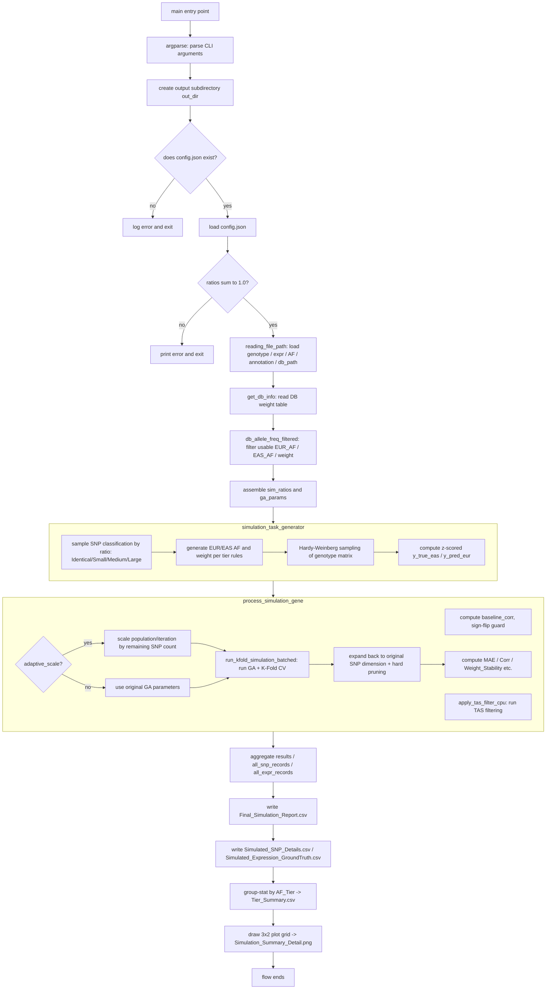

# GA_Simulation.py Documentation

## 1. Purpose and Overall Flow

`GA_Simulation.py` is a **simulation validation script**. Its purpose is to validate — without any real EAS (East Asian) population expression data — whether the GA (Genetic Algorithm) weight-transfer algorithm in `GA.py` can genuinely convert EUR (European) population-trained PrediXcan weights into weights suitable for the EAS population, using allele-frequency (AF) difference information, via **synthetic data**.

Overall logic:

1. Sample from the real database (DB, containing real EUR_AF / EAS_AF / weight), and split SNPs into four tiers based on the size of the AF difference between EUR and EAS:
   - **Identical**: AF difference = 0, EUR and EAS weights are identical (positive control group).
   - **Small**: AF difference ≤ 0.05, weights are only scaled slightly (simulating a case that's "almost directly transferable").
   - **Medium**: AF difference between 0.05 and 0.25, weights are split into "effect" and "noise" (weight set to zero) categories, simulating SNPs that partially lose predictive power across populations.
   - **Large**: AF difference > 0.25, likewise split into effect/noise, with an even more extreme random weight range, used to test whether GA can correctly identify noise SNPs and suppress their weight under the hardest scenario.
2. Use synthetic genotype (sampled by Hardy-Weinberg proportions) together with the weights above to compute "fake" real EAS expression (ground truth), and "fake" EUR predicted expression (simulating the uncalibrated PrediXcan prediction).
3. Run TAS filtering (Tier-Adaptive Scaling filter, which first filters out/down-weights unreliable SNPs) for each synthetic gene, then feed it into `V4.Weight_GA_Cupy` to run GA, deriving "scaling factors" via Repeated K-Fold Cross-Validation that convert the EUR weight into a GA-optimized EAS weight.
4. Compute metrics — correlation before/after GA, weight error, noise-suppression ratio, etc. — for each gene and each SNP, aggregate them grouped by AF Tier (Identical/Small/Medium/Large), and finally output CSV reports and visualization plots (correlation distributions, weight-error distributions, with significance annotated via Fisher's exact test + multiple-comparison correction).

In short: **this is an end-to-end validation pipeline that "fabricates data from real AF/weight distributions → runs GA → checks GA's ability to recover the ground truth"**, used to quantify the GA algorithm's trustworthiness before any real EAS expression data is available.

---

## 2. Main Flow Mermaid Flowchart



---

## 3. Function-by-Function Reference

### 3.1 `simulation_task_generator(...)`

**What this function does:**
A Python generator (using `yield`) that produces a complete set of simulation data for "one synthetic gene" per call, producing `n_genes` times in total. It's responsible for: sampling AF/weight from the real DB table, generating EUR/EAS weight differences by tier rules, simulating genotype by Hardy-Weinberg proportions, and computing z-scored expression values.

**Input parameters (key ones):**
- `n_genes`: how many genes to simulate.
- `n_samples`: how many "people" (samples) to simulate per gene.
- `n_snps_min` / `n_snps_max`: the SNP-count range per gene (the actual count is sampled from a Beta distribution, with the mean landing around 25; higher `concentration` makes the distribution tighter).
- `out_dir`: output folder path, simply attached to the returned dict for downstream convenience.
- `ga_params`: GA and per-tier threshold/bound settings (`s_tier_low/high`, `m_tier_low/high`, `l_tier_low/high`, `s_tier_threshold`, `m_tier_threshold`).
- `db_weight_freq_table`: the real database's EUR_AF / EAS_AF / weight table — the sampling pool for all tiers.
- `sim_ratios`: sampling probabilities for the four tiers (identical/small/medium/large, must sum to 1), plus `sign_flip_prob` (the probability of randomly flipping the sign of an M/L-tier weight, simulating a cross-population directional reversal).
- `l_effect_ratio` / `m_effect_ratio`: the fraction of L-tier / M-tier SNPs that are genuinely "effect" SNPs; the rest are treated as noise (EAS weight set directly to 0).
- `out_range`: whether to widen the L-tier weight's random range to create extreme outliers, for testing GA's robustness.
- `outlier_scaling`: the widening multiplier when `out_range=True`.

**How it's used/called:**
```python
gen = simulation_task_generator(
    n_genes=50, n_samples=200, n_snps_min=10, n_snps_max=80,
    out_dir="./Simulation/xxx", ga_params=ga_params,
    db_weight_freq_table=db_weight_filtered,
    sim_ratios={'identical':0.4,'small':0.3,'medium':0.2,'large':0.1,'sign_flip_prob':0.0},
    seed_base=42, l_effect_ratio=0.3, m_effect_ratio=0.7,
)
for task in gen:
    ...  # task is a dict, passed to process_simulation_gene
```

**Key internal logic:**
- **Tier meaning:**
  - Identical: EUR_AF = EAS_AF, EUR weight = EAS weight, representing a SNP that transfers perfectly across populations (positive control).
  - Small (AF diff ≤ 0.05): EAS weight = EUR weight × multiplier, where the multiplier's magnitude/direction depends on the AF difference (the larger the difference, the wider the allowed scaling range).
  - Medium (0.05–0.25) and Large (>0.25): first use `m_effect_ratio`/`l_effect_ratio` to decide which SNPs are "effect", the rest are "noise" (EAS weight forced to 0, meaning GA is expected to suppress these SNPs' weight toward zero). Effect SNPs' weights use a **bimodal distribution**: half fall in an "amplifying interval", half in a "shrinking interval" — this interval is deliberately aligned with the GA algorithm's own initialization search space, ensuring the simulated "ground truth" is something GA has a chance of finding.
  - `a_vec = clip(1 - af_diff, 0, 1)`: the larger the AF difference, the smaller a_vec — meaning this SNP's signal should be attenuated (this vector is multiplied into the final weight formula).
- **`sign_flip_prob`**: with a certain probability, flips the sign of an effect SNP's EAS weight entirely, simulating the extreme scenario where "the same SNP acts in opposite directions in the two populations".
- **Genotype sampling**: using the EAS allele frequency `af`, computes genotype probabilities 0/1/2 via the Hardy-Weinberg equilibrium formula `[(1-af)^2, 2*af*(1-af), af^2]`, then draws each sample's genotype with `rng.choice`.
- **Output expression values**: `y_true_eas = G @ eas_w` (true EAS expression) and `y_pred_eur = G @ eur_w` (prediction with the EUR weight applied directly) — both are z-score standardized, for convenient downstream correlation computation.

---

### 3.2 `run_kfold_simulation_batched(G_gpu, y_gpu, w_gpu, a_vec_gpu, rsid_list, **ga_params)`

**What this function does:**
Runs "batched Repeated K-Fold cross-validation" on the GPU (CuPy): converts each fold's train/validation split into a "mask" fed to GA (`V4.Weight_GA_Cupy`), running all fold × repeat tasks in one pass — replacing the traditional "one GA call per fold" approach, and drastically reducing the number of GPU calls (from `n_folds` down to `ceil(total_tasks / batch_limit)`).

**Input/output parameters:**
- Input: `G_gpu` (genotype, shape (n_snps, n_samples)), `y_gpu` (target expression), `w_gpu` (starting/EUR weight), `a_vec_gpu` (AF-similarity decay vector), `rsid_list` (SNP name list).
- `**ga_params` uses `num_runs` (GA repeats per fold, averaged, to reduce randomness), `n_splits` (K in K-Fold), `n_repeats` (RepeatedKFold repetition count, 1 = ordinary K-Fold), `cv_seed` (random seed for splitting), `batch_limit` (max tasks sent to GA per batch, to avoid GPU memory overflow).
- Returns: `performance_df` (each sample's out-of-fold predicted and actual values, standardized against training-set statistics), `weight_hist_df` (each fold's average GA scaling coefficient, columns keyed by rsid), `weight_stability` (average standard deviation of weights across folds — lower means more stable GA convergence), `train_corr` (a "training correlation" computed from all data + fold-averaged weights, used only for overfitting diagnosis, not a true validation metric).

**How it's used/called:**
Not normally called directly from outside — it's called from within `process_simulation_gene`:
```python
perf_df, weight_hist_df, weight_stability, train_corr = run_kfold_simulation_batched(
    G_gpu, y_gpu, w_gpu, a_vec_gpu, rsid_dummy, **ga_params_gene
)
```

**Key internal logic:**
- Uses a `(total_tasks, 1, n_samples)` binary mask to indicate "which samples are the test set in this fold/run" (value 0), because `G_gpu` is shared across all folds and doesn't need to be actually sliced and rebuilt — saving memory and computation.
- Each fold's target `y` is standardized using that fold's **training-set** mean/std (avoiding test-set information leaking into training); the standardized `y_norm` is broadcast to all `num_runs` GA executions under that fold.
- Validation-set predictions are likewise re-standardized using the training-set predictions' mean/std, to keep the comparison basis consistent (not using the test set's own statistics, to avoid information leakage).
- Prediction results across all folds are accumulated by sample index, then divided by "the number of times that sample was used as a test sample" to get the average (under RepeatedKFold, the same sample can be a test sample multiple times).
- `weight_stability` is the standard deviation of the GA scaling coefficient across folds — a small value means the weights trained across different folds are consistent and the algorithm is stable; a large value means the result is highly sensitive to the training sample.

---

### 3.3 `process_simulation_gene(task)`

**What this function does:**
Full processing for a single gene: reads in the task produced by `simulation_task_generator` → computes the pre-GA baseline correlation → runs TAS filtering → applies adaptive scaling if needed → calls `run_kfold_simulation_batched` to run GA + CV → expands results from "post-filter dimension" back to "original SNP dimension" → computes evaluation metrics and returns them.

**Input/output parameters:**
- Input: `task` (a dict, one single `yield` from `simulation_task_generator`, containing genotype, true/starting weights, a_vec, ga_params, etc.).
- Output: on success, returns a dict containing summary metrics (`N_SNPs`, `N_SNPs_After_Filter`, `Expr_MAE_EUR`, `Expr_MAE`, `Weight_MAE`, `Weight_Corr`, `Weight_Stability`, `Corr_Before`, `Corr_After`, `Train_Corr`, `Improvement`, `Time`, `Status: 'Success'`), plus arrays for per-SNP/per-sample records (`w_final`, `is_effect`, `tas_kept_mask`, `y_ga_pred_z`, `y_actual_z`, `avg_scaling`). On failure, returns `{'Status': 'Failed'}`.

**How it's used/called:**
```python
for task in gen:
    res = process_simulation_gene(task)
    if res['Status'] == 'Success':
        ...  # collect stats, write to report
```

**Key internal logic:**
- **Sign-flip guard**: if `allow_sign_flip=True` but this gene's baseline correlation (predicting with the plain EUR weight, before GA) is already ≥ `sign_flip_threshold`, sign-flip search is disabled for this gene (since a positive baseline correlation already exists, there's no need to try reversing direction) — behavior kept consistent with `V3.py`.
- **TAS filter (`apply_tas_filter_cpu`)**: runs unconditionally for every gene, filtering/down-weighting unreliable SNPs by AF-difference magnitude, and returns `keep_idx` so later results in the "filtered" space can be mapped back to "original" SNP indices.
- **`adaptive_scale`**: only affects GA's `population_size` and the three phases' `iter_num` (scaled proportionally by `scale = min(1, n_snps_after/ref_snps)`, where `n_snps_after` is the SNP count remaining after filtering relative to `adaptive_ref_snps`, guaranteed not to go below `min_population`/`min_iter1/2/3`) — it **does not** affect the TAS filtering itself; the goal is to let small genes (few SNPs) run faster while keeping enough search strength for large genes.
- **Result expansion**: GA only operates on the "post-filter" SNPs; the `avg_scaling` array is averaged in the filtered dimension first, then mapped back to the original dimension via `keep_idx`; for SNPs filtered out by TAS, `avg_scaling` stays 0, equivalent to GA judging them as noise.
- **Hard pruning**: computes `effective_w = |w_start * a_vec * avg_scaling|`; anything below `pruning_threshold` (default `1e-8`) is forced to zero, avoiding noise from floating-point residue.
- **The three correlation siblings**: `Corr_Before` (pre-GA, EUR weight directly predicting vs. true EAS — the baseline), `Corr_After` (post-GA, out-of-fold validation prediction vs. actual value — the real validation metric), `Train_Corr` (computed from all samples + fold-averaged weights, used only to judge overfitting, not representative of generalization ability).

---

### 3.4 `main()`

**What this function does:**
The entry point of the whole script, responsible for: parsing CLI arguments → reading the config file and the real database → assembling the simulation and GA parameter dicts → running the full simulation + GA flow gene by gene → aggregating results → writing CSV reports and visualization plots.

**Input/output parameters:**
- Input: no function parameters — reads command-line arguments via `argparse` (see "How to Run" below).
- Output: no return value, but produces under `out_dir`:
  - `Final_Simulation_Report.csv`: one row of summary metrics per gene.
  - `Simulated_SNP_Details.csv`: one row of detail per gene per SNP (including tier classification, true/final weight, AF, GA scaling factor, etc.).
  - `Simulated_Expression_GroundTruth.csv`: one row per gene per sample, of true/predicted expression values.
  - `Tier_Summary.csv`: error and noise-suppression-ratio statistics grouped by AF Tier (Identical/Small/Medium/Large).
  - `Simulation_Summary_Detail.png`: a 3×2 grid of plots (gene-level / SNP-level weight-error distributions, and before/after-GA correlation distribution bar charts, with significance stars annotated via Fisher's exact test + FDR correction).

**How it's used/called:**
Run directly as a command-line script — see the "How to Run" example below. The internal flow is:
1. Compose a distinct output subdirectory name from the ratio/sign_flip/sample-count parameters (avoiding different configurations overwriting each other).
2. Read `config.json` (via `V4.reading_file_path`) to get the real data locations for genotype, expression, AF, annotation, DB path, etc.
3. Use `get_db_info` + `db_allele_freq_filtered` to prepare the weight/AF data pool for `simulation_task_generator`.
4. Iterate over tasks produced by `simulation_task_generator`, handing each to `process_simulation_gene`.
5. Collect successful results, write out four CSVs, and attempt plotting (a plotting failure only produces a warning, not an interruption of the whole flow).

**Key internal logic:**
- Ratio check: `ratio_identical + ratio_small + ratio_medium + ratio_large` must sum to 1.0, otherwise the run errors out immediately (to avoid an invalid SNP classification probability).
- Tier_Summary statistics: maps per-SNP records via `AF_Diff_Cat` (0–3) to the `Identical/Small/Medium/Large` labels, and separately computes "effect SNPs' relative/absolute error, average GA scaling factor, average effective weight" and "null SNPs' noise-suppression ratio" (`|GA_Weight_Final| / |EUR_Weight_Biased|`, closer to 0 means more successful noise suppression).
- The visualization has two internal nested functions: `make_bar_data` (bins each of the two correlation columns and stacks them into long-format data for the bar chart) and `add_significance_asterisks` (runs Fisher's exact test on each correlation interval, collects all p-values, applies multiple-comparison correction via `statsmodels.multipletests` (default `fdr_bh`), and finally annotates `*`/`**`/`***` based on the corrected p-value).

---

### 3.5 `get_args` (argparse) Parameter Reference Inside `main()`

`GA_Simulation.py` has no standalone `get_args()` function — all CLI arguments are written directly in the `argparse.ArgumentParser` at the top of `main()`. The following is organized in the order `parser.add_argument` calls appear in the source.

**Simulation Data Scale**

| Argument | Type | Default | Description |
|---|---|---|---|
| `--out_dir` | str | `./Simulation` | Output root directory; the actual output is created in a subdirectory under it based on the parameter combination. |
| `--n_genes` | int | `50` | Number of synthetic genes to simulate. |
| `--n_samples` | int | `200` | Number of samples ("people") to simulate per gene. |
| `--n_snps_min` | int | `10` | Lower bound of SNP count per gene. |
| `--n_snps_max` | int | `80` | Upper bound of SNP count per gene (the actual count is sampled from a Beta distribution, with the mean landing around 25). |
| `--seed` | int | `42` | Random seed for `simulation_task_generator`, ensuring reproducibility. |

**Effect / Noise Ratios**

| Argument | Type | Default | Description |
|---|---|---|---|
| `--l_effect_ratio` | float | `0.3` | Fraction of L-tier SNPs that are genuinely "effect"; the rest are treated as noise (EAS weight set to 0). |
| `--m_effect_ratio` | float | `0.7` | Fraction of M-tier SNPs that are genuinely "effect". |

**AF Tier Sampling Ratios (the `ratio_*` values must sum to 1.0, otherwise the run errors out immediately)**

| Argument | Type | Default | Description |
|---|---|---|---|
| `--ratio_identical` | float | `0.4` | Sampling probability for the Identical tier (AF diff = 0). |
| `--ratio_small` | float | `0.3` | Sampling probability for the Small tier (AF diff ≤ `s_tier_af_diff`). |
| `--ratio_medium` | float | `0.2` | Sampling probability for the Medium tier. |
| `--ratio_large` | float | `0.1` | Sampling probability for the Large tier. |
| `--sign_flip_prob` | float | `0.0` | Probability of randomly flipping the sign of an effect M/L-tier SNP's EAS weight (direction reversal); `0.0` means disabled. |

**Sign-Flip (on the GA search side — a different thing from the simulation-side `sign_flip_prob` above)**

| Argument | Type | Default | Description |
|---|---|---|---|
| `--allow_sign_flip` | flag (store_true) | `False` | Let GA use negative scaling coefficients on L/M-tier (direction-flip search). |
| `--sign_flip_threshold` | float | `0.1` | Only enable GA's sign-flip search for a gene when its baseline correlation is below this value. (Different from `GA.py`'s default of `0.01` — this default is more lenient.) |

**Outlier Simulation**

| Argument | Type | Default | Description |
|---|---|---|---|
| `--out_range` / `--no-out_range` | bool (`BooleanOptionalAction`) | `False` | Whether to widen the L-tier weight's random range, deliberately creating extreme outliers to test GA robustness. |
| `--outlier_scaling` | float | `2.0` | Widening multiplier when `out_range=True`: upper bound `[m_high, l_high*k]`, lower bound `[l_low/k, m_low]`. |

**Data Source Configuration**

| Argument | Type | Default | Description |
|---|---|---|---|
| `--config` | str | `config.json` | Points to the JSON config file required by `GA.reading_file_path`, containing real genotype/expr/AF/annotation/DB paths, used to supply the tier-sampling data pool. |

**GA Hyperparameters (Iterations / Population Size)**

| Argument | Type | Default | Description |
|---|---|---|---|
| `--GA_Phase1_iterations` | int | `200` | GA Phase 1 max iterations (note: `GA.py`'s default is `500` — this script defaults smaller to speed up simulation). |
| `--GA_Phase2_iterations` | int | `200` | GA Phase 2 max iterations (`GA.py` default `750`). |
| `--GA_Phase3_iterations` | int | `100` | GA Phase 3 max iterations (`GA.py` default `250`). |
| `--Initial_mutation_rate` | float | `0.5` | GA initial mutation rate. |
| `--runs` (`dest=Numbers_of_GA_runs`) | int | `5` | GA repeats per fold, averaged. |
| `--pop_size` (`dest=GA_population_sizes`) | int | `200` | Population size. |

**Tier Boundaries (note: parameter names differ from `GA.py` — no `_max` suffix here)**

| Argument | Type | Default | Description |
|---|---|---|---|
| `--s_tier_af_diff` | float | `0.05` | S-tier max AF-difference threshold (corresponds to `GA.py`'s `--s_tier_af_diff_max`). |
| `--s_tier_low_bound` | float | `0.9` | S-tier scaling-coefficient lower bound. |
| `--s_tier_high_bound` | float | `1.1` | S-tier scaling-coefficient upper bound. |
| `--m_tier_af_diff` | float | `0.25` | M-tier max AF-difference threshold (corresponds to `--m_tier_af_diff_max`). |
| `--m_tier_low_bound` | float | `0.4` | M-tier bimodal lower-interval lower bound (`GA.py` default `0.5`). |
| `--m_tier_high_bound` | float | `3.0` | M-tier bimodal upper-interval upper bound. |
| `--l_tier_low_bound` | float | `0.0` | L-tier bimodal lower-interval lower bound (`GA.py` default `0.1`). |
| `--l_tier_high_bound` | float | `5.0` | L-tier bimodal upper-interval upper bound. |

**GPU / Batch Control**

| Argument | Type | Default | Description |
|---|---|---|---|
| `--batch_limit` | int | `2048` | Max parallel tasks (fold × run) sent to GPU per batch. |

**Cross-Validation (this script always uses K-Fold / Repeated K-Fold — no `--cv_method`, no `loocv` option)**

| Argument | Type | Default | Description |
|---|---|---|---|
| `--n_splits` | int | `5` | K in K-Fold. |
| `--n_repeats` | int | `1` | RepeatedKFold repetition count (`1` = ordinary K-Fold; `GA.py`'s default is `3`). |
| `--cv_seed` | int | `42` | Random seed for fold splitting. |

**Adaptive Scaling / TAS Filtering (same meaning as the identically-named parameters in `GA.py`)**

| Argument | Type | Default | Description |
|---|---|---|---|
| `--adaptive_scale` / `--no-adaptive_scale` | bool (`BooleanOptionalAction`) | `True` | Whether to scale population/iterations by the SNP count remaining after TAS filtering. |
| `--adaptive_ref_snps` | int | `20` | Reference SNP count for adaptive scaling. |
| `--min_population` | int | `300` | Lower bound on population size. |
| `--min_iter1` | int | `200` | Lower bound on Phase 1 iteration count. |
| `--min_iter2` | int | `300` | Lower bound on Phase 2 iteration count. |
| `--min_iter3` | int | `100` | Lower bound on Phase 3 iteration count. |
| `--tas_decay_scale` | float | `0.20` | Decay scale for TAS transferability decay. |
| `--tas_keep_frac_ml` | float | `0.8` | Fraction of M/L-tier SNPs kept by TAS score. |
| `--tas_min_snps_to_filter` | int | `5` | SNP count below which TAS filtering is skipped. |

> **Note (differences from `GA.py`)**: `GA_Simulation.py` has no `--pruning_threshold` CLI argument — the pruning threshold is hardcoded in-code as `1e-8`; it also has no `--test_mode`/`--test_count`/`--test_seed`/`--plot_thread` (the simulation script is itself a small-scale test tool and doesn't need further sub-sampling); `--cv_method` doesn't exist either, because the simulation always uses `run_kfold_simulation_batched` (K-Fold/Repeated K-Fold), with no LOOCV option.

---

## 4. How to Run (Command-Line Example)

```powershell
python GA_Simulation.py `
    --config config.json `
    --out_dir ./Simulation `
    --n_genes 50 `
    --n_samples 200 `
    --n_snps_min 10 `
    --n_snps_max 80 `
    --seed 42 `
    --ratio_identical 0.4 --ratio_small 0.3 --ratio_medium 0.2 --ratio_large 0.1 `
    --sign_flip_prob 0.0 `
    --GA_Phase1_iterations 200 --GA_Phase2_iterations 200 --GA_Phase3_iterations 100 `
    --runs 5 --pop_size 200 `
    --n_splits 5 --n_repeats 1 --cv_seed 42 `
    --adaptive_scale `
    --tas_decay_scale 0.20 --tas_keep_frac_ml 0.8 --tas_min_snps_to_filter 5
```

Common flags, elaborated:
- `--config`: required; points to the JSON config file needed by `V4.reading_file_path`, containing the real data's paths.
- `--out_range` / `--no-out_range`: whether to widen the L-tier random range to create extreme outliers (`BooleanOptionalAction`).
- `--allow_sign_flip`: enables GA's sign-flip search (used together with `--sign_flip_threshold`).
- `--adaptive_scale` / `--no-adaptive_scale`: whether to adjust GA population/iteration scale based on the SNP count after TAS filtering.

After execution, results are written to a subdirectory like `./Simulation/id0.4_sm0.3_med0.2_lg0.1_sfp0.0_S200_as1/`.

---

## 5. Batch Runner Script `Simu_pipeline.sh` (`run_simulation_grid.sh`)

`Simu_pipeline.sh` is a "grid search" batch script that uses three nested loops to run `GA_Simulation.py` once for every combination of **Mode (whether GA sign-flip is enabled) × AF Tier ratio combination × sample count**, making it convenient to generate multiple sets of simulation results for comparison in one go.

### 5.1 Structure

```bash
CONFIG="/mnt/data_80T/anywaycheng/GA/Testing/simu_config.json"
SIM_SCRIPT="/mnt/data_80T/anywaycheng/GA/Testing/GA_Simulation.py"
BASE_OUT="/mnt/data_80T/anywaycheng/GA/Testing/Simulation"
LOG_DIR="${BASE_OUT}/logs"
```
- Paths are centralized at the top — only these lines need to change when switching machines/datasets.

- `FIXED_PARAMS`: the array of parameters shared across every run, corresponding to `GA_Simulation.py`'s `get_args`:
  - `--n_splits 10 --n_repeats 5 --cv_seed 42`: Repeated 10-Fold CV.
  - `--GA_Phase1_iterations 500 --GA_Phase2_iterations 750 --GA_Phase3_iterations 250`: more complete iteration counts than the defaults (200/200/100).
  - `--pop_size 1500 --runs 50`: much larger population and repeat count than the defaults (200/5) — suitable for high-quality simulations intended for formal output.
  - `--s_tier_af_diff 0.05 --m_tier_af_diff 0.25`: tier boundaries.
  - `--adaptive_scale`: enables adaptive scaling (**note: the script's source has a stray trailing backslash `\` at the end of this line, which is a harmless extra character in bash array syntax and doesn't affect execution, but it's worth cleaning up to avoid confusion**).
  - `--batch_limit 12800`: GPU per-batch task-count cap (noticeably higher than `GA_Simulation.py`'s default of `2048`, requires more GPU memory).
  - `--n_genes 100 --n_snps_min 5 --n_snps_max 100`: simulation scale.
  - `--l_effect_ratio 0.3 --m_effect_ratio 0.7 --seed 42`.

- `MODE_CONFIGS`: defines the "Mode" level, each line in the format
  `"sign_flip_prob  dir_name  out_range(0/1)  outlier_scaling  use_sign_flip(0/1)"`.
  Two default modes:
  - `SimuFlip_NoFlipGA`: the simulated data has a 5% chance of flipped direction (`sign_flip_prob=0.05`), but GA does **not** enable sign-flip search → tests GA's performance when "unaware direction flips exist" (expected to perform worse, as a control group).
  - `SimuFlip_FlipGA`: same simulated data, but GA **enables** `--allow_sign_flip --sign_flip_threshold 0.1` → tests whether enabling sign-flip search can correct for it.
  - Two additional `out_range` lines are currently commented out (starting with `#`); uncomment them when you need to add an extreme-outlier scenario.

- `RATIO_CONFIGS`: defines AF Tier ratio combinations, each line in the format `"id sm med lg  label"`, four default sets (`medium_heavy`/`fully_balanced`/`small_heavy`/`large_heavy`), all fixed at `ratio_identical=0.0` (excluding the identical tier, focusing on scenarios that actually need transfer calibration).

- `SAMPLE_SIZES=(100 200)`: sample counts to test (`--n_samples`); the commented-out `(50 100 150 200 250)` is a more thorough sweep range.

- Three nested loops `for MODE_ENTRY → for RATIO_ENTRY → for N_SAMPLES`, calling once per combination:
  ```bash
  python "${SIM_SCRIPT}" "${FIXED_PARAMS[@]}" "${OR_FLAGS[@]}" "${SF_FLAGS[@]}" \
      --out_dir "${MODE_OUT}" --n_samples "${N_SAMPLES}" --sign_flip_prob "${SFP}" \
      --ratio_identical "${ID}" --ratio_small "${SM}" --ratio_medium "${MED}" --ratio_large "${LG}"
  ```
  output simultaneously to the terminal and to `${LOG_DIR}/run${N}_....log` via `tee`.

### 5.2 Usage

```bash
chmod +x Simu_pipeline.sh
./Simu_pipeline.sh
```

By default this runs `2 modes × 4 ratio configs × 2 sample sizes = 16` simulations; total time depends on the GPU and parameter scale (`pop_size=1500, runs=50, n_genes=100` is a heavyweight setting).

### 5.3 Common Adjustments

| Need | How to change it |
|---|---|
| Switch dataset/paths | Change `CONFIG` / `SIM_SCRIPT` / `BASE_OUT` at the top; if the script has been renamed to `GA_Simulation.py`, be sure to update `SIM_SCRIPT` in sync. |
| Speed up a single run (small-scale validation first) | Lower `--pop_size`, `--runs`, `--n_genes`, `--GA_Phase*_iterations` in `FIXED_PARAMS`. |
| Want to test more sample-count combinations | Uncomment `SAMPLE_SIZES=(50 100 150 200 250)`, and comment out the current `(100 200)`. |
| Want to add outlier scenarios | Uncomment the two `OutRange` lines in `MODE_CONFIGS`. |
| Want to add more tier-ratio combinations | Add a new line `"id sm med lg label"` to the `RATIO_CONFIGS` array; the four ratios must sum to 1.0 (corresponding to the internal check in `GA_Simulation.py` — otherwise that run errors out immediately). |
| Adjust sign-flip-related behavior | Change `sign_flip_prob` or `use_sign_flip` on each line of `MODE_CONFIGS`; the GA-side `--sign_flip_threshold` is currently hardcoded to `0.1` in `SF_FLAGS` — edit that line of code directly if you need to change it. |
| GPU out of memory | Lower `--batch_limit` (currently `12800`) and/or `--pop_size`. |
| Want to run multiple sets in parallel (multiple GPUs) | The script currently runs fully sequentially; if you have multiple GPUs, you can split `MODE_CONFIGS`/`RATIO_CONFIGS` into multiple scripts yourself, each with its own `CUDA_VISIBLE_DEVICES` launched in parallel (note: `GA.py`/`GA_Simulation.py`'s source currently hardcodes `CUDA_VISIBLE_DEVICES` to `"1"` — this needs to be removed or made overridable via environment variable before multi-GPU parallelism). |

Run logs are named `run${RUN_IDX}_${DIR_NAME}_${LABEL}_S${N_SAMPLES}.log`, stored under `${BASE_OUT}/logs/`, for convenient comparison of each combination's success/failure and detailed output.
