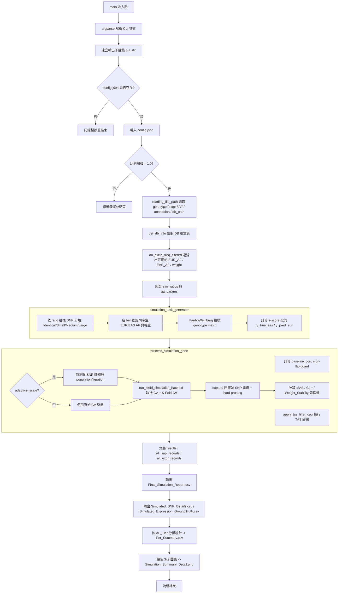

# GA_Simulation.py 說明文件

## 1. 用途與整體流程概述

`GA_Simulation.py` 是一個**模擬驗證腳本**，目的是在沒有真實 EAS（東亞）族群表現量資料的情況下，
用「合成資料（synthetic data）」來驗證 `GA.py` 裡的 GA（基因演算法, Genetic Algorithm）
權重轉移演算法，是否真的能把 EUR（歐洲）族群訓練出的 PrediXcan 權重，透過等位基因頻率
（Allele Frequency, AF）差異資訊，轉換成適用於 EAS 族群的權重。

整體邏輯：

1. 從真實資料庫（DB，包含真實 EUR_AF / EAS_AF / weight）取樣，依照 EUR 與 EAS 之間的
   AF 差異大小，把 SNP 分成四個等級（tier）：
   - **Identical（完全相同）**：AF 差異 = 0，EUR 與 EAS 權重完全一致（正對照組）。
   - **Small（小差異）**：AF 差異 ≤ 0.05，權重只做小幅度縮放（模擬「幾乎可直接轉移」的狀況）。
   - **Medium（中差異）**：AF 差異在 0.05 ~ 0.25 之間，權重被拆成「有效應（effect）」與「雜訊
     （noise，權重歸零）」兩類，模擬部分 SNP 在跨族群後失去預測力的狀況。
   - **Large（大差異）**：AF 差異 > 0.25，同樣拆成 effect / noise，且權重的隨機範圍更極端，
     用來測試 GA 在最困難情境下能否正確辨識雜訊 SNP 並壓制其權重。
2. 用合成的 genotype（依 Hardy-Weinberg 比例抽樣）與上述權重算出「假的」EAS 真實表現量
   （ground truth），以及「假的」EUR 預測表現量（模擬未校正前的 PrediXcan 預測）。
3. 對每個合成基因執行 TAS 篩選（Tier-Adaptive Scaling filter，先濾除/降權不可靠的 SNP），
   再丟進 `V4.Weight_GA_Cupy` 執行 GA，透過 Repeated K-Fold Cross-Validation 求出「縮放係數
   （scaling）」，把 EUR 權重轉換成 GA 優化後的 EAS 權重。
4. 統計每個基因、每個 SNP 在 GA 前後的相關係數、權重誤差、雜訊壓制比例等指標，並依照
   AF Tier（Identical/Small/Medium/Large）分組彙整，最後輸出 CSV 報表與視覺化圖表
   （相關係數分布、權重誤差分布，並用 Fisher's exact test + 多重比較校正標注顯著性）。

簡言之：**這是一個「拿真實 AF/weight 分布造假資料 → 跑 GA → 檢查 GA 還原真相的能力」的
端對端（end-to-end）驗證管線**，用來在沒有真實 EAS 表現量資料前，量化 GA 演算法的可信度。

---

## 2. 主要流程 Mermaid Flowchart



---

## 3. 各函式中文說明

### 3.1 `simulation_task_generator(...)`

**這個函式在幹什麼：**
一個 Python generator（用 `yield`），每次呼叫產生「一個合成基因」的完整模擬資料，總共會產生
`n_genes` 次。它負責：從真實 DB 表格取樣 AF/權重、依 tier 規則製造 EUR/EAS 權重差異、
用 Hardy-Weinberg 比例模擬 genotype、計算 z-score 化的表現量。

**輸入參數（重點）：**
- `n_genes`：要模擬幾個基因。
- `n_samples`：每個基因模擬幾個「人」（樣本數）。
- `n_snps_min` / `n_snps_max`：每個基因的 SNP 數量區間（實際數量用 Beta 分布抽樣，讓平均值
  落在 25 附近，`concentration` 越高分布越集中）。
- `out_dir`：輸出資料夾路徑，單純附加在回傳的 dict 中方便下游使用。
- `ga_params`：GA 與各 tier 的門檻/上下界設定（`s_tier_low/high`、`m_tier_low/high`、
  `l_tier_low/high`、`s_tier_threshold`、`m_tier_threshold`）。
- `db_weight_freq_table`：真實資料庫的 EUR_AF / EAS_AF / weight 表，是所有 tier 取樣的來源池。
- `sim_ratios`：四個 tier 的抽樣機率（identical/small/medium/large 需總和為 1），以及
  `sign_flip_prob`（M/L-tier 權重隨機翻轉正負號的機率，模擬跨族群方向性反轉）。
- `l_effect_ratio` / `m_effect_ratio`：L-tier / M-tier 中真正「有效應」SNP 的比例，其餘視為雜訊
  （EAS 權重直接設為 0）。
- `out_range`：是否放大 L-tier 的權重隨機範圍，製造極端 outlier，用來測試 GA 的穩健性。
- `outlier_scaling`：`out_range=True` 時的放大倍率。

**如何使用/呼叫方式：**
```python
gen = simulation_task_generator(
    n_genes=50, n_samples=200, n_snps_min=10, n_snps_max=80,
    out_dir="./Simulation/xxx", ga_params=ga_params,
    db_weight_freq_table=db_weight_filtered,
    sim_ratios={'identical':0.4,'small':0.3,'medium':0.2,'large':0.1,'sign_flip_prob':0.0},
    seed_base=42, l_effect_ratio=0.3, m_effect_ratio=0.7,
)
for task in gen:
    ...  # task 是一個 dict，交給 process_simulation_gene 處理
```

**重要內部邏輯：**
- **Tier 意義**：
  - Identical：EUR_AF = EAS_AF，EUR 權重 = EAS 權重，代表跨族群完全可轉移的 SNP（正對照）。
  - Small（AF差 ≤ 0.05）：EAS 權重 = EUR 權重 × multiplier，multiplier 依 AF 差異大小決定放大或
    縮小的幅度（差異越大，允許的縮放範圍越寬）。
  - Medium（0.05~0.25）與 Large（>0.25）：先用 `m_effect_ratio`/`l_effect_ratio` 決定哪些 SNP是
    「有效應」，其餘是「雜訊」（EAS 權重強制為 0，代表 GA 應該把這些 SNP 的權重壓到接近零）。
    有效應 SNP 的權重採用**雙峰分布（bimodal）**：一半落在「放大區間」、一半落在「縮小區間」，
    這個區間刻意對齊 GA 演算法本身初始化搜尋空間的範圍，確保模擬出來的「地面真相（ground
    truth）」是 GA 有機會找到的答案。
  - `a_vec = clip(1 - af_diff, 0, 1)`：AF 差異越大，a_vec 越小，代表這個 SNP 的訊號應該被削弱
    （這個向量會乘進最終權重公式）。
- **sign_flip_prob**：以一定機率把 effect SNP 的 EAS 權重整個變號，模擬「同一個 SNP 在兩個族群
  中作用方向相反」的極端情境。
- **Genotype 抽樣**：依照 EAS 的等位基因頻率 `af`，用 Hardy-Weinberg 平衡公式算出基因型 0/1/2
  的機率 `[(1-af)^2, 2*af*(1-af), af^2]`，再用 `rng.choice` 抽出每個樣本的基因型。
- **輸出的表現量**：`y_true_eas = G @ eas_w`（真實 EAS 表現量）與 `y_pred_eur = G @ eur_w`
  （EUR 權重直接套用的預測值），兩者都做 z-score 標準化，方便後續計算相關係數。

---

### 3.2 `run_kfold_simulation_batched(G_gpu, y_gpu, w_gpu, a_vec_gpu, rsid_list, **ga_params)`

**這個函式在幹什麼：**
在 GPU（CuPy）上執行「批次化的 Repeated K-Fold 交叉驗證」，把每一個 fold 的訓練/驗證切分，
轉換成一個「遮罩（mask）」丟給 GA（`V4.Weight_GA_Cupy`），一次跑完所有 fold × repeat 的任務，
取代傳統「一個 fold 呼叫一次 GA」的做法，大幅減少 GPU 呼叫次數（把呼叫數從 `n_folds` 降到
`ceil(total_tasks / batch_limit)`）。

**輸入輸出參數：**
- 輸入：`G_gpu`（genotype，shape 為 (n_snps, n_samples)）、`y_gpu`（目標表現量）、
  `w_gpu`（起始/EUR 權重）、`a_vec_gpu`（AF 相似度衰減向量）、`rsid_list`（SNP 名稱列表）。
- `**ga_params` 中會用到 `num_runs`（每個 fold 跑幾次 GA 取平均，降低隨機性）、`n_splits`
  （K-Fold 的 K）、`n_repeats`（RepeatedKFold 重複次數，1 代表普通 K-Fold）、`cv_seed`
  （切分用的隨機種子）、`batch_limit`（單次丟給 GA 的最大任務數，避免 GPU 記憶體爆掉）。
- 回傳：`performance_df`（每個樣本的 out-of-fold 預測值與實際值，經過訓練集統計量標準化）、
  `weight_hist_df`（每個 fold 的 GA 平均縮放係數，欄位為 rsid）、`weight_stability`
  （跨 fold 權重的標準差平均，數值越低代表 GA 收斂越穩定）、`train_corr`
  （用全部資料 + fold 平均權重算出的「訓練相關係數」，僅作為過擬合診斷用，不是真正的驗證指標）。

**如何使用/呼叫方式：**
通常不會被外部直接呼叫，而是在 `process_simulation_gene` 內部被呼叫：
```python
perf_df, weight_hist_df, weight_stability, train_corr = run_kfold_simulation_batched(
    G_gpu, y_gpu, w_gpu, a_vec_gpu, rsid_dummy, **ga_params_gene
)
```

**重要內部邏輯：**
- 用一個 `(total_tasks, 1, n_samples)` 的二值遮罩表示「哪些樣本在這個 fold/run 中是測試集」
  （值為 0），因為 `G_gpu` 對所有 fold 是共用的，不需要真的切片重建矩陣，節省記憶體與運算。
- 每個 fold 的目標值 `y` 是用「該 fold 的訓練集」平均值/標準差做標準化（避免測試集資訊洩漏到
  訓練過程），標準化後的 `y_norm` 會廣播（broadcast）給該 fold 底下所有 `num_runs` 次 GA 執行。
- 驗證集的預測值同樣用「訓練集預測值的均值/標準差」重新標準化，確保比較基準一致（不使用測試
  集自己的統計量，避免資訊洩漏）。
- 所有 fold 的預測結果會依樣本索引累加，最後除以「該樣本被當作測試樣本的次數」得到平均值
  （RepeatedKFold 下同一個樣本可能被當作測試樣本多次）。
- `weight_stability` 是跨 fold 的 GA 縮放係數標準差，數值小代表不同 fold 訓練出的權重很一致，
  演算法穩定；數值大代表結果對訓練樣本高度敏感。

---

### 3.3 `process_simulation_gene(task)`

**這個函式在幹什麼：**
處理單一基因的完整流程：讀入 `simulation_task_generator` 產生的任務 → 計算 GA 執行前的 baseline
相關係數 → 執行 TAS 篩選 → 視需要做 adaptive scaling → 呼叫 `run_kfold_simulation_batched` 跑
GA + CV → 把結果從「篩選後維度」展開回「原始 SNP 維度」→ 計算各項評估指標並回傳。

**輸入輸出參數：**
- 輸入：`task`（一個 dict，來自 `simulation_task_generator` 的單次 yield，包含 genotype、
  真實/起始權重、a_vec、ga_params 等）。
- 輸出：成功時回傳一個 dict，包含摘要指標（`N_SNPs`、`N_SNPs_After_Filter`、`Expr_MAE_EUR`、
  `Expr_MAE`、`Weight_MAE`、`Weight_Corr`、`Weight_Stability`、`Corr_Before`、`Corr_After`、
  `Train_Corr`、`Improvement`、`Time`、`Status: 'Success'`），以及供逐 SNP/逐樣本記錄用的陣列
  （`w_final`、`is_effect`、`tas_kept_mask`、`y_ga_pred_z`、`y_actual_z`、`avg_scaling`）。
  失敗時回傳 `{'Status': 'Failed'}`。

**如何使用/呼叫方式：**
```python
for task in gen:
    res = process_simulation_gene(task)
    if res['Status'] == 'Success':
        ...  # 蒐集統計數據、寫入報表
```

**重要內部邏輯：**
- **Sign-flip guard**：如果 `allow_sign_flip=True`，但這個基因的 baseline 相關係數（GA 執行前，
  單純用 EUR 權重預測）已經大於等於 `sign_flip_threshold`，就會關閉這個基因的 sign-flip 搜尋
  （因為 baseline 已經有正相關，不需要再嘗試反轉方向），行為與 `V3.py` 保持一致。
- **TAS filter（`apply_tas_filter_cpu`）**：無條件對每個基因執行，會依 AF 差異大小過濾/降權不
  可靠的 SNP，回傳 `keep_idx` 讓後續能把「篩選後」結果映射回「原始」SNP 索引。
- **adaptive_scale**：只影響 GA 的 `population_size` 與三個 phase 的 `iter_num`（依照篩選後剩餘
  SNP 數 `n_snps_after` 相對於 `adaptive_ref_snps` 的比例 `scale = min(1, n_snps_after/ref_snps)`
  做等比例縮放，並保證不低於 `min_population`/`min_iter1/2/3`），**不會**影響 TAS 篩選本身，
  目的是讓小基因（SNP 少）跑得更快，大基因維持足夠的搜尋強度。
- **結果展開（expand）**：GA 只在「篩選後」的 SNP 上運算，`avg_scaling` 陣列先在篩選後維度算
  平均，再用 `keep_idx` 映射回原始維度；被 TAS 濾掉的 SNP，`avg_scaling` 保持為 0，等同於
  GA 判定它是雜訊。
- **Hard pruning**：計算 `effective_w = |w_start * a_vec * avg_scaling|`，凡是小於
  `pruning_threshold`（預設 `1e-8`）就強制歸零，避免浮點數殘留造成雜訊。
- **相關係數三兄弟**：`Corr_Before`（GA 前，EUR 權重直接預測 vs. 真實 EAS，基準線）、
  `Corr_After`（GA 後，out-of-fold 驗證預測 vs. 實際值，真正的驗證指標）、`Train_Corr`
  （用全部樣本 + fold 平均權重算出，僅供判斷是否過擬合，不代表泛化能力）。

---

### 3.4 `main()`

**這個函式在幹什麼：**
整個腳本的進入點，負責：解析 CLI 參數 → 讀取設定檔與真實資料庫 → 組出模擬與 GA 參數字典 →
逐基因跑完整個模擬 + GA 流程 → 彙整結果 → 輸出 CSV 報表與視覺化圖表。

**輸入輸出參數：**
- 輸入：無函式參數，透過 `argparse` 讀取命令列參數（詳見下方「如何執行」）。
- 輸出：無回傳值，但會在 `out_dir` 下產生：
  - `Final_Simulation_Report.csv`：每個基因一列的摘要指標。
  - `Simulated_SNP_Details.csv`：每個基因每個 SNP 一列的細節（含 tier 分類、真實/最終權重、
    AF、GA 縮放係數等）。
  - `Simulated_Expression_GroundTruth.csv`：每個基因每個樣本一列的表現量真值/預測值。
  - `Tier_Summary.csv`：依 AF Tier（Identical/Small/Medium/Large）分組統計的誤差與雜訊壓制比。
  - `Simulation_Summary_Detail.png`：3x2 網格圖（基因層級 / SNP 層級的權重誤差分布，以及
    GA 前後相關係數分布長條圖，並用 Fisher's exact test + FDR 校正標注顯著性星號）。

**如何使用/呼叫方式：**
直接以命令列腳本執行，見下方「如何執行」範例。內部流程為：
1. 依照 ratio/sign_flip/sample 數等參數組出獨立的輸出子資料夾名稱（避免不同設定互相覆蓋）。
2. 讀取 `config.json`（透過 `V4.reading_file_path`）取得 genotype、表現量、AF、annotation、
   DB 路徑等真實資料位置。
3. 用 `get_db_info` + `db_allele_freq_filtered` 準備給 `simulation_task_generator` 用的權重/AF
   資料池。
4. 逐一取出 `simulation_task_generator` 產生的 task，交給 `process_simulation_gene` 處理。
5. 蒐集成功結果，寫出四份 CSV，並嘗試繪圖（繪圖失敗只會警告，不會讓整個流程中斷）。

**重要內部邏輯：**
- 比例檢查：`ratio_identical + ratio_small + ratio_medium + ratio_large` 必須總和為 1.0，否則
  直接報錯結束（避免 SNP 分類機率不合法）。
- Tier_Summary 統計：把逐 SNP 記錄依 `AF_Diff_Cat`（0~3）對應到 `Identical/Small/Medium/Large`
  標籤，分別計算「effect SNP 的相對/絕對誤差、平均 GA 縮放係數、平均有效權重」與「null SNP 的
  雜訊壓制比（`|GA_Weight_Final| / |EUR_Weight_Biased|`，越接近 0 代表雜訊壓制越成功）」。
- 視覺化圖表中有兩個內部巢狀函式：`make_bar_data`（把兩欄相關係數各自分箱、堆疊成長條圖用的
  長格式資料）與 `add_significance_asterisks`（對每個相關係數區間跑 Fisher's exact test，先收集
  所有 p-value，再用 `statsmodels.multipletests`（預設 `fdr_bh`）做多重比較校正，最後依校正後
  p-value 標注 `*`/`**`/`***`）。

---

### 3.5 `main()` 內 `get_args`（argparse）參數詳解

`GA_Simulation.py` 沒有獨立的 `get_args()` 函式，所有 CLI 參數都直接寫在 `main()` 開頭的 `argparse.ArgumentParser` 中；以下依原始碼中 `parser.add_argument` 出現順序整理。

**模擬資料規模**

| 參數 | 型別 | 預設值 | 說明 |
|---|---|---|---|
| `--out_dir` | str | `./Simulation` | 輸出根目錄；實際輸出會在其下依參數組合再建立子目錄。 |
| `--n_genes` | int | `50` | 要模擬幾個合成基因。 |
| `--n_samples` | int | `200` | 每個基因模擬幾個樣本（人）。 |
| `--n_snps_min` | int | `10` | 每個基因 SNP 數量下界。 |
| `--n_snps_max` | int | `80` | 每個基因 SNP 數量上界（實際數量由 Beta 分布抽樣，平均落在 25 附近）。 |
| `--seed` | int | `42` | `simulation_task_generator` 的隨機種子，確保可重現。 |

**Effect / Noise 比例**

| 參數 | 型別 | 預設值 | 說明 |
|---|---|---|---|
| `--l_effect_ratio` | float | `0.3` | L-tier SNP 中真正「有效應」的比例，其餘視為雜訊（EAS 權重設為 0）。 |
| `--m_effect_ratio` | float | `0.7` | M-tier SNP 中真正「有效應」的比例。 |

**AF Tier 抽樣比例（`ratio_*` 總和必須 = 1.0，否則直接報錯結束）**

| 參數 | 型別 | 預設值 | 說明 |
|---|---|---|---|
| `--ratio_identical` | float | `0.4` | Identical tier（AF 差 = 0）的 SNP 抽樣機率。 |
| `--ratio_small` | float | `0.3` | Small tier（AF 差 ≤ `s_tier_af_diff`）的抽樣機率。 |
| `--ratio_medium` | float | `0.2` | Medium tier 的抽樣機率。 |
| `--ratio_large` | float | `0.1` | Large tier 的抽樣機率。 |
| `--sign_flip_prob` | float | `0.0` | Effect M/L-tier SNP 的 EAS 權重隨機變號（方向反轉）的機率；`0.0` 表示不啟用。 |

**Sign-Flip（GA 搜尋端，與上面模擬端的 `sign_flip_prob` 是兩回事）**

| 參數 | 型別 | 預設值 | 說明 |
|---|---|---|---|
| `--allow_sign_flip` | flag (store_true) | `False` | 讓 GA 在 L/M-tier 允許負值縮放係數（方向翻轉搜尋）。 |
| `--sign_flip_threshold` | float | `0.1` | 只有當該基因 baseline 相關係數低於此值時，才對該基因啟用 GA 的 sign-flip 搜尋。（與 `GA.py` 預設的 `0.01` 不同，這裡預設較寬鬆。） |

**Outlier 模擬**

| 參數 | 型別 | 預設值 | 說明 |
|---|---|---|---|
| `--out_range` / `--no-out_range` | bool (`BooleanOptionalAction`) | `False` | 是否放大 L-tier 的權重隨機範圍，刻意製造極端 outlier 以測試 GA 穩健性。 |
| `--outlier_scaling` | float | `2.0` | `out_range=True` 時的放大倍率：上界 `[m_high, l_high*k]`、下界 `[l_low/k, m_low]`。 |

**資料來源設定**

| 參數 | 型別 | 預設值 | 說明 |
|---|---|---|---|
| `--config` | str | `config.json` | 指向 `GA.reading_file_path` 所需的 JSON 設定檔，內含真實 genotype/expr/AF/annotation/DB 路徑，用來提供 tier 取樣的資料池。 |

**GA 超參數（迭代 / 族群大小）**

| 參數 | 型別 | 預設值 | 說明 |
|---|---|---|---|
| `--GA_Phase1_iterations` | int | `200` | GA Phase 1 最大迭代數（注意：`GA.py` 預設是 `500`，此腳本預設較小以加速模擬）。 |
| `--GA_Phase2_iterations` | int | `200` | GA Phase 2 最大迭代數（`GA.py` 預設 `750`）。 |
| `--GA_Phase3_iterations` | int | `100` | GA Phase 3 最大迭代數（`GA.py` 預設 `250`）。 |
| `--Initial_mutation_rate` | float | `0.5` | GA 起始突變率。 |
| `--runs`（`dest=Numbers_of_GA_runs`） | int | `5` | 每個 fold 跑幾次 GA 取平均。 |
| `--pop_size`（`dest=GA_population_sizes`） | int | `200` | 族群個體數。 |

**Tier 邊界（與 `GA.py` 對照時要注意參數名稱不同：這裡沒有 `_max` 尾綴）**

| 參數 | 型別 | 預設值 | 說明 |
|---|---|---|---|
| `--s_tier_af_diff` | float | `0.05` | S-tier 最大 AF 差異門檻（對應 `GA.py` 的 `--s_tier_af_diff_max`）。 |
| `--s_tier_low_bound` | float | `0.9` | S-tier 縮放係數下界。 |
| `--s_tier_high_bound` | float | `1.1` | S-tier 縮放係數上界。 |
| `--m_tier_af_diff` | float | `0.25` | M-tier 最大 AF 差異門檻（對應 `--m_tier_af_diff_max`）。 |
| `--m_tier_low_bound` | float | `0.4` | M-tier 雙峰下段下界（`GA.py` 預設 `0.5`）。 |
| `--m_tier_high_bound` | float | `3.0` | M-tier 雙峰上段上界。 |
| `--l_tier_low_bound` | float | `0.0` | L-tier 雙峰下段下界（`GA.py` 預設 `0.1`）。 |
| `--l_tier_high_bound` | float | `5.0` | L-tier 雙峰上段上界。 |

**GPU / 批次控制**

| 參數 | 型別 | 預設值 | 說明 |
|---|---|---|---|
| `--batch_limit` | int | `2048` | 單次送進 GPU 的最大平行任務數（fold × run）。 |

**Cross-Validation（此腳本固定用 K-Fold / Repeated K-Fold，沒有 `--cv_method`，也沒有 `loocv` 選項）**

| 參數 | 型別 | 預設值 | 說明 |
|---|---|---|---|
| `--n_splits` | int | `5` | K-Fold 的 K。 |
| `--n_repeats` | int | `1` | RepeatedKFold 重複次數（`1` = 一般 K-Fold；`GA.py` 預設是 `3`）。 |
| `--cv_seed` | int | `42` | fold 切分用隨機種子。 |

**Adaptive Scaling / TAS 篩選（與 `GA.py` 同名參數意義相同）**

| 參數 | 型別 | 預設值 | 說明 |
|---|---|---|---|
| `--adaptive_scale` / `--no-adaptive_scale` | bool (`BooleanOptionalAction`) | `True` | 是否依 TAS 篩選後剩餘 SNP 數縮放 population/iterations。 |
| `--adaptive_ref_snps` | int | `20` | Adaptive scaling 參考 SNP 數。 |
| `--min_population` | int | `300` | Population size 下限。 |
| `--min_iter1` | int | `200` | Phase 1 迭代數下限。 |
| `--min_iter2` | int | `300` | Phase 2 迭代數下限。 |
| `--min_iter3` | int | `100` | Phase 3 迭代數下限。 |
| `--tas_decay_scale` | float | `0.20` | TAS 可轉移性衰減 decay scale。 |
| `--tas_keep_frac_ml` | float | `0.8` | M/L-tier 依 TAS 分數保留比例。 |
| `--tas_min_snps_to_filter` | int | `5` | SNP 數低於此值不做 TAS 篩選。 |

> **注意（與 `GA.py` 的差異）**：`GA_Simulation.py` 沒有 `--pruning_threshold` CLI 參數，剪枝門檻在程式內硬編碼為 `1e-8`；也沒有 `--test_mode`/`--test_count`/`--test_seed`/`--plot_thread`（模擬腳本本身就是小規模測試工具，不需要再抽樣）；`--cv_method` 也不存在，因為模擬固定使用 `run_kfold_simulation_batched`（K-Fold/Repeated K-Fold），沒有 LOOCV 選項。

---

## 4. 如何執行（Command-Line 範例）

```powershell
python GA_Simulation.py `
    --config config.json `
    --out_dir ./Simulation `
    --n_genes 50 `
    --n_samples 200 `
    --n_snps_min 10 `
    --n_snps_max 80 `
    --seed 42 `
    --ratio_identical 0.4 --ratio_small 0.3 --ratio_medium 0.2 --ratio_large 0.1 `
    --sign_flip_prob 0.0 `
    --GA_Phase1_iterations 200 --GA_Phase2_iterations 200 --GA_Phase3_iterations 100 `
    --runs 5 --pop_size 200 `
    --n_splits 5 --n_repeats 1 --cv_seed 42 `
    --adaptive_scale `
    --tas_decay_scale 0.20 --tas_keep_frac_ml 0.8 --tas_min_snps_to_filter 5
```

常用旗標補充：
- `--config`：必填，指向 `V4.reading_file_path` 所需的 JSON 設定檔，內含真實資料的路徑。
- `--out_range` / `--no-out_range`：是否放大 L-tier 隨機範圍製造極端 outlier（`BooleanOptionalAction`）。
- `--allow_sign_flip`：開啟 GA 的正負號翻轉搜尋（配合 `--sign_flip_threshold` 使用）。
- `--adaptive_scale` / `--no-adaptive_scale`：是否依 TAS 篩選後的 SNP 數量調整 GA 族群/迭代規模。

執行完成後，結果會輸出到形如
`./Simulation/id0.4_sm0.3_med0.2_lg0.1_sfp0.0_S200_as1/` 的子目錄中。

---

## 5. 批次執行腳本 `Simu_pipeline.sh`（`run_simulation_grid.sh`）

`Simu_pipeline.sh` 是一個「網格搜尋（grid search）」批次腳本，用三層巢狀迴圈把 **Mode（是否啟用 GA sign-flip）× AF Tier 比例組合 × 樣本數** 的所有組合都跑過一次 `GA_Simulation.py`，方便一次性產生多組模擬結果用於比較。

### 5.1 結構說明

```bash
CONFIG="/mnt/data_80T/anywaycheng/GA/Testing/simu_config.json"
SIM_SCRIPT="/mnt/data_80T/anywaycheng/GA/Testing/GA_Simulation.py"
BASE_OUT="/mnt/data_80T/anywaycheng/GA/Testing/Simulation"
LOG_DIR="${BASE_OUT}/logs"
```
- 路徑集中在最上面，換機器/換資料時只需改這幾行。

- `FIXED_PARAMS`：所有跑次共用的固定參數陣列，對應到 `GA_Simulation.py` 的 `get_args`：
  - `--n_splits 10 --n_repeats 5 --cv_seed 42`：Repeated 10-Fold CV。
  - `--GA_Phase1_iterations 500 --GA_Phase2_iterations 750 --GA_Phase3_iterations 250`：比預設值（200/200/100）更完整的迭代數。
  - `--pop_size 1500 --runs 50`：比預設值（200/5）大很多的族群與重複次數，適合正式產出用的高品質模擬。
  - `--s_tier_af_diff 0.05 --m_tier_af_diff 0.25`：tier 邊界。
  - `--adaptive_scale`：開啟 adaptive scaling（**注意腳本原始碼這一行結尾多了一個反斜線 `\`，在 bash 陣列語法中是無害的多餘符號，不影響執行，但建議清理掉以免誤導**）。
  - `--batch_limit 12800`：GPU 單批任務數上限（明顯高於 `GA_Simulation.py` 預設的 `2048`，需要較大 GPU 記憶體）。
  - `--n_genes 100 --n_snps_min 5 --n_snps_max 100`：模擬規模。
  - `--l_effect_ratio 0.3 --m_effect_ratio 0.7 --seed 42`。

- `MODE_CONFIGS`：定義「Mode」層級，每行格式為
  `"sign_flip_prob  dir_name  out_range(0/1)  outlier_scaling  use_sign_flip(0/1)"`。
  預設兩個 mode：
  - `SimuFlip_NoFlipGA`：模擬資料有 5% 機率翻轉方向（`sign_flip_prob=0.05`），但 GA **不**開啟 sign-flip 搜尋 → 用來測試 GA 在「不知道有方向翻轉」情況下的表現（預期較差，做對照組）。
  - `SimuFlip_FlipGA`：同樣的模擬資料，但 GA **開啟** `--allow_sign_flip --sign_flip_threshold 0.1` → 測試開啟 sign-flip 搜尋後是否能修正。
  - 另外兩行 `out_range` 版本目前被註解掉（`#` 開頭），需要時取消註解即可加入極端 outlier 情境。

- `RATIO_CONFIGS`：定義 AF Tier 比例組合，每行格式為 `"id sm med lg  label"`，預設四組（`medium_heavy`/`fully_balanced`/`small_heavy`/`large_heavy`），皆固定 `ratio_identical=0.0`（不含完全相同 tier，聚焦在需要轉移校正的情境）。

- `SAMPLE_SIZES=(100 200)`：要測試的樣本數（`--n_samples`）；註解掉的 `(50 100 150 200 250)` 是更完整的掃描範圍。

- 三層迴圈 `for MODE_ENTRY → for RATIO_ENTRY → for N_SAMPLES`，每個組合呼叫一次：
  ```bash
  python "${SIM_SCRIPT}" "${FIXED_PARAMS[@]}" "${OR_FLAGS[@]}" "${SF_FLAGS[@]}" \
      --out_dir "${MODE_OUT}" --n_samples "${N_SAMPLES}" --sign_flip_prob "${SFP}" \
      --ratio_identical "${ID}" --ratio_small "${SM}" --ratio_medium "${MED}" --ratio_large "${LG}"
  ```
  並用 `tee` 同時輸出到終端機與 `${LOG_DIR}/run${N}_....log`。

### 5.2 使用方式

```bash
chmod +x Simu_pipeline.sh
./Simu_pipeline.sh
```

預設會跑 `2 modes × 4 ratio configs × 2 sample sizes = 16` 次模擬，總耗時視 GPU 與參數規模而定（`pop_size=1500, runs=50, n_genes=100` 屬於重量級設定）。

### 5.3 常見調整方式

| 需求 | 怎麼改 |
|---|---|
| 換資料集/路徑 | 改最上面的 `CONFIG` / `SIM_SCRIPT` / `BASE_OUT`；若腳本已改名成 `GA_Simulation.py`，務必同步更新 `SIM_SCRIPT`。 |
| 加快單次跑速（先小規模驗證流程） | 調低 `FIXED_PARAMS` 裡的 `--pop_size`、`--runs`、`--n_genes`、`--GA_Phase*_iterations`。 |
| 想跑更多樣本數組合 | 取消註解 `SAMPLE_SIZES=(50 100 150 200 250)`，並註解掉目前的 `(100 200)`。 |
| 想加入 outlier 情境 | 取消註解 `MODE_CONFIGS` 中帶 `OutRange` 的兩行。 |
| 想加入更多 tier 比例組合 | 在 `RATIO_CONFIGS` 陣列新增一行 `"id sm med lg label"`，四個比例需總和為 1.0（對應 `GA_Simulation.py` 內部的檢查，否則該次執行會直接報錯結束）。 |
| 調整 sign-flip 相關行為 | 改 `MODE_CONFIGS` 每行的 `sign_flip_prob` 或 `use_sign_flip`；GA 端的 `--sign_flip_threshold` 目前寫死在 `SF_FLAGS` 為 `0.1`，如需調整需直接修改該行程式碼。 |
| GPU 記憶體不足 | 調低 `--batch_limit`（目前 `12800`）與/或 `--pop_size`。 |
| 想並行跑多組（多張 GPU） | 目前腳本是完全循序執行；若有多張 GPU，可自行拆分 `MODE_CONFIGS`/`RATIO_CONFIGS` 成多個腳本，各自設定 `CUDA_VISIBLE_DEVICES` 後平行啟動（注意 `GA.py`/`GA_Simulation.py` 目前原始碼中把 `CUDA_VISIBLE_DEVICES` 寫死為 `"1"`，多 GPU 平行前需要先移除或改為可由環境變數覆蓋）。 |

執行紀錄會依 `run${RUN_IDX}_${DIR_NAME}_${LABEL}_S${N_SAMPLES}.log` 命名，存於 `${BASE_OUT}/logs/`，方便逐一比對每個組合的成功/失敗與詳細輸出。