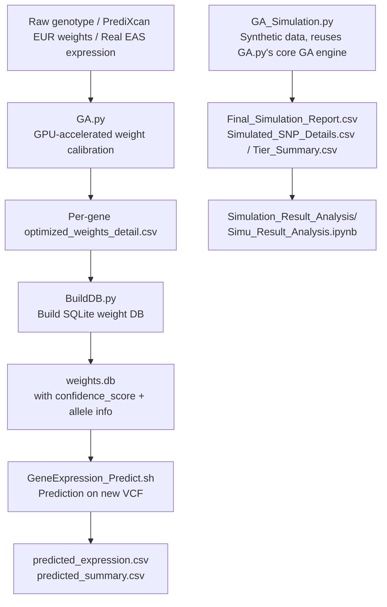
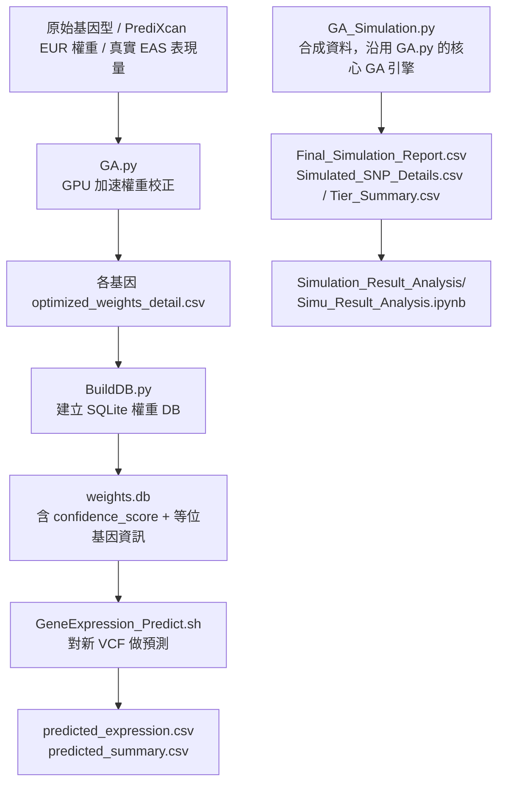

# GA-Based Cross-Population Gene Expression Weight Calibration

**Languages:** [English](#english) | [中文](#中文)

---

<a id="english"></a>
# English

## 📖 Overview

This project implements a **GPU-accelerated Genetic Algorithm (GA)** pipeline to calibrate [PrediXcan](https://github.com/hakyimlab/PrediXcan) gene expression prediction model weights originally trained on European (EUR) populations, adapting them for East Asian (EAS) populations.

### Background

PrediXcan models are trained on EUR GWAS/eQTL data. When applied directly to EAS populations, prediction accuracy degrades due to differences in **Allele Frequency (AF)** and **Linkage Disequilibrium (LD)** structure between populations — especially for SNPs with large AF differences.

### Solution

1. Classify each SNP into **S/M/L tiers** based on EUR/EAS AF difference
2. Run **3-phase GA** to search for a **scaling factor** per tier, applied to original PrediXcan weights to maximize correlation with real EAS expression data
3. Validate with **LOOCV or K-Fold** cross-validation to prevent overfitting
4. Apply **TAS (Transferability-Adjusted Score)** filter before GA to remove the least transferable SNPs

---

## 🗂️ Repository Structure

```
(repo root)
├── README.md                          # This file
│
├── GA_and_Simu_Program/                # All scripts and per-module docs
│   ├── GA.py                           # Main GA calibration engine (GPU, V4)
│   ├── GA_pipeline.sh                  # Batch runner for GA (LOOCV / K-Fold × Sign / Unsign)
│   ├── GA_Simulation.py                # Simulation validation script
│   ├── Simu_pipeline.sh                # Grid-search batch runner for simulation
│   ├── simu_config.json                # Config template for simulation
│   ├── BuildDB.py                      # Post-processing: merge CSVs → SQLite weight DB
│   ├── GeneExpression_Predict.py       # Downstream prediction script (VCF → predicted expression)
│   ├── GeneExpression_Predict.sh       # Prediction pipeline entry point
│   ├── GA.md / GA.en.md                # Detailed documentation for GA.py (zh / en)
│   ├── Simulation.md / Simulation.en.md            # Detailed documentation for GA_Simulation.py (zh / en)
│   ├── BuildDB.md / BuildDB.en.md                  # Detailed documentation for BuildDB.py (zh / en)
│   └── GeneExpression_Predict.md / .en.md          # Detailed documentation for prediction pipeline (zh / en)
│
├── PredictTesting/                     # Test prediction results (see below)
│   ├── predicted_predicted_expression.csv
│   └── predicted_summary.csv
│
├── Simulation_Result_Analysis/          # Analysis of GA_Simulation.py output (not built into weights.db)
│   ├── Simu_Result_Analysis.ipynb      # Analysis notebook
│   └── Simu_Result_Analysis_doc.md     # Notebook documentation
│
└── data/
    └── README.md                       # Notes on large data files stored on server
```

---

## 🔬 Module Descriptions

### 1. `GA_and_Simu_Program/GA.py` — Core GA Engine

The main calibration program. Uses CuPy + Numba CUDA for GPU-parallelized 3-phase GA optimization.

**Key features:**
- SNP tiering by EUR/EAS AF difference (S/M/L tier)
- 3-phase GA optimization with warm-start inheritance between phases
- Failure fallback mechanism: expands search space if a phase converges poorly
- Adaptive scaling of population/iteration by remaining SNP count after TAS filtering
- LOOCV and Repeated K-Fold cross-validation support
- Async background plotting via `ThreadPoolExecutor`

**Fitness function:**
```
loss = -arctanh(correlation)  [Fisher-z transform]
     + population_diversity_penalty
```

**Quick start:**
```powershell
python GA.py `
    --config config.json `
    --cv_method loocv `
    --GA_Phase1_iterations 500 `
    --GA_Phase2_iterations 750 `
    --GA_Phase3_iterations 250 `
    --GA_population_sizes 500 `
    --Numbers_of_GA_runs 50 `
    --s_tier_af_diff_max 0.05 `
    --m_tier_af_diff_max 0.25 `
    --tas_keep_frac_ml 0.8 `
    --adaptive_scale `
    --batch_limit 2048
```

> `config.json` must contain: `genotype_path`, `predict_expr_path`, `real_expr_path`, `allele_freq_path`, `annotation_path`, `db_path`, `out_dir`

---

### 2. `GA_and_Simu_Program/GA_pipeline.sh` — Batch Execution

Runs up to 6 job combinations (LOOCV / 10-Fold / 3-Fold × Sign / Unsign). By default, only LOOCV Sign + Unsign are enabled.

**Usage:**
```bash
chmod +x GA_pipeline.sh
./GA_pipeline.sh
```

Control flags at the top of the script:
```bash
RUN_LOOCV_SIGN=true    # Recommended default
RUN_LOOCV_UNSIGN=true
RUN_10FOLD_SIGN=false  # Enable only for CV method comparison
RUN_10FOLD_UNSIGN=false
RUN_3FOLD_SIGN=false
RUN_3FOLD_UNSIGN=false
```

---

### 3. `GA_and_Simu_Program/GA_Simulation.py` — Simulation Validation

Validates the GA algorithm using **synthetic data** derived from real EUR/EAS AF distributions, without needing real EAS expression data.

**Pipeline:**
1. Sample SNPs from real DB by AF tier (Identical / Small / Medium / Large)
2. Synthesize EUR weights and EAS "ground truth" weights with tier-specific noise
3. Generate genotypes via Hardy-Weinberg sampling
4. Run GA calibration on synthetic data
5. Compare GA-recovered weights to ground truth → output metrics and plots

```bash
python GA_Simulation.py \
    --config simu_config.json \
    --n_genes 50 --n_samples 200 \
    --ratio_identical 0.4 --ratio_small 0.3 --ratio_medium 0.2 --ratio_large 0.1 \
    --GA_Phase1_iterations 200 --GA_Phase2_iterations 200 --GA_Phase3_iterations 100 \
    --runs 5 --pop_size 200 \
    --n_splits 5 --n_repeats 1
```

---

### 4. `GA_and_Simu_Program/BuildDB.py` — Build Weight Database

Merges per-gene `optimized_weights_detail.csv` files output by `GA.py` into a single SQLite `.db` for downstream use.

**Optional features:**
- `--score`: Compute `confidence_score` and `suggestion` per SNP weight
- `--predixcan_db`: Supplement `chr`, `pos`, `ref_allele`, `eff_allele` from original PrediXcan model DB

**Usage:**
```bash
# Basic merge
python BuildDB.py \
    --base_dir "/path/to/V4_LOOCV_Sign" \
    --out_db   "/path/to/weights.db"

# Full recommended usage (with scoring + allele info)
python BuildDB.py \
    --base_dir     "/path/to/V4_LOOCV_Sign" \
    --out_db       "/path/to/weights.db" \
    --summary_csv  "/path/to/V4_LOOCV_Sign/final_summary.csv" \
    --predixcan_db "/path/to/gtex_v7_Lung_imputed_europeans_tw_0_5_signif.db" \
    --score
```

---

### 5. `GA_and_Simu_Program/GeneExpression_Predict.py` / `.sh` — Prediction Pipeline

Takes a user's VCF file and outputs predicted gene expression using GA-calibrated weights.

**Formula:**
```
PredictedExpression(gene, sample) = Σ_i  GA_W(gene, SNP_i) × dosage(SNP_i, sample)
```

**Usage:**
```bash
chmod +x GeneExpression_Predict.sh
./GeneExpression_Predict.sh genotype.vcf [output_dir]
```

**Outputs:**
- `predicted_predicted_expression.csv` — Wide-format predicted expression (samples × genes), compatible with PrediXcan output format
- `predicted_summary.csv` — Per-gene QC summary (SNP coverage, `var_g`, `confidence_score`, status flags)

---

## 📊 Overall Pipeline



> Note: `GA_Simulation.py` shares the same underlying GA optimization engine as `GA.py`, but its output is **never** merged into `weights.db` — it only produces validation metrics/plots, analyzed separately in [`Simulation_Result_Analysis/`](./Simulation_Result_Analysis/). Only the real-data path (`GA.py` → `BuildDB.py` → `weights.db`) feeds the prediction pipeline.

---

## ⚙️ Requirements

| Dependency | Version | Note |
|---|---|---|
| Python | 3.11+ | |
| CuPy | Latest | GPU computation |
| Numba | Latest | CUDA kernels |
| pandas | Latest | Data manipulation |
| numpy | Latest | Numerical computation |
| statsmodels | Latest | Statistical tests |
| plink2 | Latest | VCF → dosage matrix (prediction pipeline only) |
| sqlite3 | Built-in | Weight database |

**GPU requirement:** NVIDIA GPU with CUDA support (tested on CUDA device `"1"` in `GA_pipeline.sh`)

---

## 📁 Data

Training and testing input data files (genotype, expression, allele frequency, annotation) are too large for GitHub and are stored on the server.

See [`data/README.md`](./data/README.md) for details.

---

## 📂 Prediction Results

Test prediction results are included in this repo under [`PredictTesting/`](./PredictTesting/):

| File | Description |
|---|---|
| `predicted_predicted_expression.csv` | Predicted expression matrix (samples × genes) |
| `predicted_summary.csv` | Per-gene QC: SNP coverage, confidence score, GA vs PrediXcan correlation, status |

**Status distribution in test results:** All genes show `LOW_SNP_COVERAGE` status, indicating the test VCF only partially overlaps with the model SNPs — expected behavior for cross-cohort testing.

### `predicted_predicted_expression.csv` — Column Reference

Wide format, one row per sample, one column per gene:

| Column | Description |
|---|---|
| `FID` / `IID` | Sample ID from the VCF/plink2 |
| `ENSG...` (one column per gene) | Predicted expression value for that sample × gene (raw scale; z-score standardize per-column yourself if needed) |

> Only genes with **at least 1 SNP found in the VCF** appear as a column here. A gene with zero SNP hits is entirely absent from this file — check its `status` in `predicted_summary.csv` (it will be `NO_SNPS_IN_VCF`).

### `predicted_summary.csv` — Column Reference

One row per gene, covering **every** gene in `weights.db` (not just successfully predicted ones):

| Column | Description |
|---|---|
| `gene` | Gene ID |
| `n_snps_in_model` | Number of non-zero-weight SNPs after GA calibration |
| `n_snps_used` | Number of SNPs actually found in the VCF and orientation-aligned this run |
| `pct_snps_used` | `n_snps_used / n_snps_in_model` — this gene's model coverage on this VCF |
| `pred_mean` / `pred_sd` | Mean / standard deviation of predicted expression across this sample batch |
| `var_g` | Variance of predicted expression (`pred_sd²`); `var_g = 0` means no discriminative power in this batch |
| `avg_confidence_score` | Average `confidence_score` (from `BuildDB.py`) across the SNPs actually used |
| `train_corr` / `corr_after_GA` | This gene's overall GA training/validation performance (from `final_summary.csv`) |
| `n_snps` | Total original SNPs used when training this gene with GA (incl. later-pruned) |
| `status` | Quality flag for this prediction run — see table below |

**`status` values:**

| status | Meaning |
|---|---|
| `OK` | Normal, `n_snps_used` coverage ≥ 50% |
| `LOW_SNP_COVERAGE` | Some SNPs found but coverage < 50%; use with caution |
| `NO_SNPS_IN_VCF` | None of the gene's model SNPs appear in this VCF; gene is absent from the expression CSV |
| `NO_MODEL_SNPS` | Gene was entirely pruned during GA (`n_snps_in_model = 0`); unrelated to this VCF |
| `ZERO_VARIANCE` | Predicted, but identical for every sample in this batch (`var_g = 0`) |

> Recommended: filter downstream analysis to `status == 'OK'` (optionally also `LOW_SNP_COVERAGE`) before trusting the predictions.

---

## 📄 Detailed Documentation

- [`GA_and_Simu_Program/GA.en.md`](./GA_and_Simu_Program/GA.en.md) — Full parameter reference and internals for `GA.py`
- [`GA_and_Simu_Program/Simulation.en.md`](./GA_and_Simu_Program/Simulation.en.md) — Simulation design and all CLI parameters for `GA_Simulation.py`
- [`GA_and_Simu_Program/BuildDB.en.md`](./GA_and_Simu_Program/BuildDB.en.md) — Confidence score formula, all parameters for `BuildDB.py`
- [`GA_and_Simu_Program/GeneExpression_Predict.en.md`](./GA_and_Simu_Program/GeneExpression_Predict.en.md) — Output format spec and usage for prediction pipeline
- [`Simulation_Result_Analysis/Simu_Result_Analysis_doc.md`](./Simulation_Result_Analysis/Simu_Result_Analysis_doc.md) — Documentation for the `GA_Simulation.py` result analysis notebook (Chinese only)

<br>

---
---

<a id="中文"></a>
# 中文

## 📖 專案概述

本專案實作一套以 **GPU（CuPy + Numba CUDA）平行化的遺傳演算法（GA）** 管線，用於校正以歐洲人（EUR）族群訓練的 [PrediXcan](https://github.com/hakyimlab/PrediXcan) 基因表現量預測模型權重，使其更準確地轉移到東亞人（EAS）族群。

### 背景問題

PrediXcan 模型以 EUR 族群的 GWAS/eQTL 資料訓練。直接套用到 EAS 族群時，因為兩族群間的**等位基因頻率 (Allele Frequency, AF)** 與**連鎖不平衡 (LD)** 結構不同，預測準確度會下降，尤其是 AF 差異越大的 SNP 問題越嚴重。

### 解法

1. 根據 EUR/EAS AF 差異，把每個 SNP 分類到 **S/M/L tier**
2. 執行 **三階段 GA**，為每個 tier 搜尋一個**縮放係數**，套用在原始 PrediXcan 權重上，最大化與真實 EAS 表現量資料的相關係數
3. 用 **LOOCV 或 K-Fold** 交叉驗證，避免過擬合
4. 在跑 GA 之前，先用 **TAS（Transferability-Adjusted Score）** filter 濾除最不可轉移的 SNP

---

## 🗂️ 專案結構

```
(repo 根目錄)
├── README.md                          # 本文件
│
├── GA_and_Simu_Program/                # 所有程式碼與各模組文件
│   ├── GA.py                           # 主要 GA 校正引擎（GPU, V4）
│   ├── GA_pipeline.sh                  # GA 批次執行腳本（LOOCV / K-Fold × Sign / Unsign）
│   ├── GA_Simulation.py                # 模擬驗證腳本
│   ├── Simu_pipeline.sh                # 模擬用網格搜尋批次腳本
│   ├── simu_config.json                # 模擬用設定檔範本
│   ├── BuildDB.py                      # 後處理：合併 CSV → SQLite 權重 DB
│   ├── GeneExpression_Predict.py       # 下游預測腳本（VCF → 預測表現量）
│   ├── GeneExpression_Predict.sh       # 預測流程進入點
│   ├── GA.md / GA.en.md                # GA.py 詳細文件（中文 / 英文）
│   ├── Simulation.md / Simulation.en.md            # GA_Simulation.py 詳細文件（中文 / 英文）
│   ├── BuildDB.md / BuildDB.en.md                  # BuildDB.py 詳細文件（中文 / 英文）
│   └── GeneExpression_Predict.md / .en.md          # 預測流程詳細文件（中文 / 英文）
│
├── PredictTesting/                     # 測試預測結果（見下方）
│   ├── predicted_predicted_expression.csv
│   └── predicted_summary.csv
│
├── Simulation_Result_Analysis/          # GA_Simulation.py 輸出結果的分析（不會 build 進 weights.db）
│   ├── Simu_Result_Analysis.ipynb      # 分析用 notebook
│   └── Simu_Result_Analysis_doc.md     # notebook 技術文件
│
└── data/
    └── README.md                       # 大型資料檔案存放於伺服器的說明
```

---

## 🔬 模組說明

### 1. `GA_and_Simu_Program/GA.py` — 核心 GA 引擎

主要校正程式。用 CuPy + Numba CUDA 做 GPU 平行化的三階段 GA 最佳化。

**主要功能：**
- 依 EUR/EAS AF 差異將 SNP 分 tier（S/M/L）
- 三階段 GA 最佳化，各階段間有暖啟動（warm-start）繼承
- 失敗回退機制：若某階段收斂不佳則擴大搜尋範圍
- 依 TAS 篩選後剩餘 SNP 數，自適應調整族群/迭代規模
- 支援 LOOCV 與 Repeated K-Fold 交叉驗證
- 透過 `ThreadPoolExecutor` 做背景非同步繪圖

**適應度公式：**
```
loss = -arctanh(correlation)  [Fisher-z 轉換]
     + population_diversity_penalty
```

**快速執行：**
```powershell
python GA.py `
    --config config.json `
    --cv_method loocv `
    --GA_Phase1_iterations 500 `
    --GA_Phase2_iterations 750 `
    --GA_Phase3_iterations 250 `
    --GA_population_sizes 500 `
    --Numbers_of_GA_runs 50 `
    --s_tier_af_diff_max 0.05 `
    --m_tier_af_diff_max 0.25 `
    --tas_keep_frac_ml 0.8 `
    --adaptive_scale `
    --batch_limit 2048
```

> `config.json` 需包含：`genotype_path`、`predict_expr_path`、`real_expr_path`、`allele_freq_path`、`annotation_path`、`db_path`、`out_dir`

---

### 2. `GA_and_Simu_Program/GA_pipeline.sh` — 批次執行腳本

最多可執行 6 種 job 組合（LOOCV / 10-Fold / 3-Fold × Sign / Unsign）。預設只開啟 LOOCV Sign + Unsign。

**使用方式：**
```bash
chmod +x GA_pipeline.sh
./GA_pipeline.sh
```

腳本最上方的開關旗標：
```bash
RUN_LOOCV_SIGN=true    # 建議預設開啟
RUN_LOOCV_UNSIGN=true
RUN_10FOLD_SIGN=false  # 只有要比較 CV 方法時才開
RUN_10FOLD_UNSIGN=false
RUN_3FOLD_SIGN=false
RUN_3FOLD_UNSIGN=false
```

---

### 3. `GA_and_Simu_Program/GA_Simulation.py` — 模擬驗證腳本

在不需要真實 EAS 表現量資料的情況下，用來自真實 EUR/EAS AF 分布的**合成資料**驗證 GA 演算法。

**流程：**
1. 依 AF tier（Identical / Small / Medium / Large）從真實 DB 取樣 SNP
2. 用各 tier 專屬的雜訊規則合成 EUR 權重與 EAS「地面真相（ground truth）」權重
3. 用 Hardy-Weinberg 抽樣生成基因型
4. 在合成資料上執行 GA 校正
5. 比較 GA 還原出的權重與地面真相 → 輸出指標與圖表

```bash
python GA_Simulation.py \
    --config simu_config.json \
    --n_genes 50 --n_samples 200 \
    --ratio_identical 0.4 --ratio_small 0.3 --ratio_medium 0.2 --ratio_large 0.1 \
    --GA_Phase1_iterations 200 --GA_Phase2_iterations 200 --GA_Phase3_iterations 100 \
    --runs 5 --pop_size 200 \
    --n_splits 5 --n_repeats 1
```

---

### 4. `GA_and_Simu_Program/BuildDB.py` — 建立權重資料庫

把 `GA.py` 輸出的每個基因的 `optimized_weights_detail.csv` 合併成一個 SQLite `.db`，供下游使用。

**選用功能：**
- `--score`：為每個 SNP 權重計算 `confidence_score` 與 `suggestion`
- `--predixcan_db`：從原始 PrediXcan model DB 補齊 `chr`、`pos`、`ref_allele`、`eff_allele`

**使用方式：**
```bash
# 基本合併
python BuildDB.py \
    --base_dir "/path/to/V4_LOOCV_Sign" \
    --out_db   "/path/to/weights.db"

# 完整建議用法（含評分 + 等位基因資訊）
python BuildDB.py \
    --base_dir     "/path/to/V4_LOOCV_Sign" \
    --out_db       "/path/to/weights.db" \
    --summary_csv  "/path/to/V4_LOOCV_Sign/final_summary.csv" \
    --predixcan_db "/path/to/gtex_v7_Lung_imputed_europeans_tw_0_5_signif.db" \
    --score
```

---

### 5. `GA_and_Simu_Program/GeneExpression_Predict.py` / `.sh` — 預測流程

輸入使用者的 VCF 檔案，用 GA 校正過的權重輸出預測基因表現量。

**公式：**
```
PredictedExpression(gene, sample) = Σ_i  GA_W(gene, SNP_i) × dosage(SNP_i, sample)
```

**使用方式：**
```bash
chmod +x GeneExpression_Predict.sh
./GeneExpression_Predict.sh genotype.vcf [output_dir]
```

**輸出：**
- `predicted_predicted_expression.csv` — 寬格式預測表現量（樣本 × 基因），相容 PrediXcan 輸出格式
- `predicted_summary.csv` — 每基因 QC 摘要（SNP 覆蓋率、`var_g`、`confidence_score`、status 旗標）

---

## 📊 完整流程



> 注意：`GA_Simulation.py` 沿用與 `GA.py` 相同的 GA 最佳化核心引擎，但其輸出**不會**被合併進 `weights.db`——它只產生驗證用的指標/圖表，另外在 [`Simulation_Result_Analysis/`](./Simulation_Result_Analysis/) 分析。只有真實資料路徑（`GA.py` → `BuildDB.py` → `weights.db`）會餵給預測流程使用。

---

## ⚙️ 環境需求

| 依賴套件 | 版本 | 備註 |
|---|---|---|
| Python | 3.11+ | |
| CuPy | 最新 | GPU 運算 |
| Numba | 最新 | CUDA kernel |
| pandas | 最新 | 資料處理 |
| numpy | 最新 | 數值運算 |
| statsmodels | 最新 | 統計檢定 |
| plink2 | 最新 | VCF → dosage 矩陣（僅預測流程需要） |
| sqlite3 | 內建 | 權重資料庫 |

**GPU 需求：** 支援 CUDA 的 NVIDIA GPU（`GA_pipeline.sh` 內測試用的是 CUDA device `"1"`）

---

## 📁 資料說明

訓練與測試的輸入資料檔案（基因型、表現量、等位基因頻率、註解檔）過大，無法存放於 GitHub，存放於伺服器上。

詳見 [`data/README.md`](./data/README.md)。

---

## 📂 預測結果

測試預測結果已包含在本 repo 的 [`PredictTesting/`](./PredictTesting/) 資料夾內：

| 檔案 | 說明 |
|---|---|
| `predicted_predicted_expression.csv` | 預測表現量矩陣（樣本 × 基因） |
| `predicted_summary.csv` | 每基因 QC：SNP 覆蓋率、可信度分數、GA 與 PrediXcan 相關係數、status |

**測試結果狀態分布：** 所有基因皆顯示 `LOW_SNP_COVERAGE` 狀態，代表測試 VCF 只跟模型 SNP 部分重疊——這是跨 cohort 測試的預期行為。

### `predicted_predicted_expression.csv` — 欄位說明

寬格式，每列一個樣本，每欄一個基因：

| 欄位 | 說明 |
|---|---|
| `FID` / `IID` | 來自 VCF/plink2 的樣本 ID |
| `ENSG...`（每個基因一欄） | 該樣本在此基因的預測表現量（原始尺度；如需標準化可自行對每欄做 z-score） |

> 只有「至少有 1 個 SNP 在這份 VCF 中被找到」的基因才會出現在這個檔案裡；完全沒有 SNP 命中的基因不會出現，需到 `predicted_summary.csv` 查其 `status`（會是 `NO_SNPS_IN_VCF`）。

### `predicted_summary.csv` — 欄位說明

每列一個基因，涵蓋 `weights.db` 裡所有基因（不只是預測成功的）：

| 欄位 | 說明 |
|---|---|
| `gene` | 基因 ID |
| `n_snps_in_model` | GA 校正後、非零權重的 SNP 數 |
| `n_snps_used` | 本次執行中，實際在 VCF 找到並成功對齊方向的 SNP 數 |
| `pct_snps_used` | `n_snps_used / n_snps_in_model`，此基因模型在這份 VCF 上的覆蓋率 |
| `pred_mean` / `pred_sd` | 這批樣本間預測表現量的平均與標準差 |
| `var_g` | 預測表現量的變異數（`pred_sd²`）；`var_g = 0` 代表此基因在這批樣本裡完全沒有鑑別度 |
| `avg_confidence_score` | 實際用到的 SNP 在 `BuildDB.py` 算出的 `confidence_score` 平均值 |
| `train_corr` / `corr_after_GA` | 該基因在 GA 訓練/驗證階段的整體表現（來自 `final_summary.csv`） |
| `n_snps` | 該基因 GA 訓練時使用的原始 SNP 總數（含後來被剪枝的） |
| `status` | 本次預測的品質旗標，見下表 |

**`status` 對照：**

| status | 意義 |
|---|---|
| `OK` | 正常，覆蓋率 ≥ 50% |
| `LOW_SNP_COVERAGE` | 有找到部分 SNP，但覆蓋率 < 50%，建議謹慎使用 |
| `NO_SNPS_IN_VCF` | 此基因的模型 SNP 完全沒有出現在這份 VCF；不會出現在表現量 CSV 裡 |
| `NO_MODEL_SNPS` | 此基因在 GA 階段就被全部剪枝，跟這次 VCF 無關 |
| `ZERO_VARIANCE` | 有算出預測值，但這批樣本全部數值相同 |

> 建議下游分析先篩 `status == 'OK'`（視情況可放寬到含 `LOW_SNP_COVERAGE`）的基因再使用，避免把覆蓋率極低或無鑑別度的預測值當成可信結果。

---

## 📄 詳細說明文件

- [`GA_and_Simu_Program/GA.md`](./GA_and_Simu_Program/GA.md) — `GA.py` 完整參數說明與內部邏輯
- [`GA_and_Simu_Program/Simulation.md`](./GA_and_Simu_Program/Simulation.md) — `GA_Simulation.py` 模擬設計與所有 CLI 參數
- [`GA_and_Simu_Program/BuildDB.md`](./GA_and_Simu_Program/BuildDB.md) — `BuildDB.py` 可信度分數公式與所有參數
- [`GA_and_Simu_Program/GeneExpression_Predict.md`](./GA_and_Simu_Program/GeneExpression_Predict.md) — 預測流程的輸出格式規格與使用方式
- [`Simulation_Result_Analysis/Simu_Result_Analysis_doc.md`](./Simulation_Result_Analysis/Simu_Result_Analysis_doc.md) — `GA_Simulation.py` 結果分析 notebook 的技術文件
