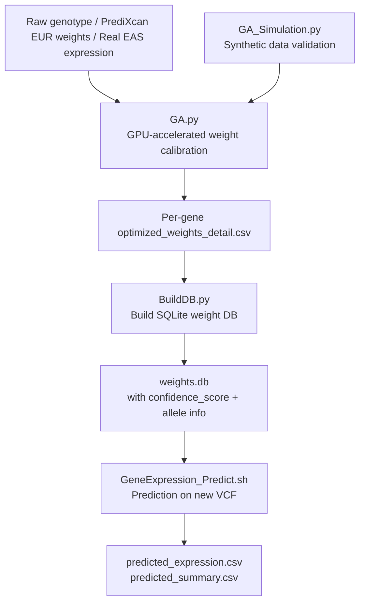

# GA-Based Cross-Population Gene Expression Weight Calibration
# 基於遺傳演算法的跨族群基因表現量權重校正系統

---

## 📖 Overview / 專案概述

This project implements a **GPU-accelerated Genetic Algorithm (GA)** pipeline to calibrate [PrediXcan](https://github.com/hakyimlab/PrediXcan) gene expression prediction model weights originally trained on European (EUR) populations, adapting them for East Asian (EAS) populations.

本專案實作一套以 **GPU（CuPy + Numba CUDA）平行化的遺傳演算法（GA）** 管線，用於校正以歐洲人（EUR）族群訓練的 [PrediXcan](https://github.com/hakyimlab/PrediXcan) 基因表現量預測模型權重，使其更準確地轉移到東亞人（EAS）族群。

### Background / 背景問題

PrediXcan models are trained on EUR GWAS/eQTL data. When applied directly to EAS populations, prediction accuracy degrades due to differences in **Allele Frequency (AF)** and **Linkage Disequilibrium (LD)** structure between populations — especially for SNPs with large AF differences.

PrediXcan 模型以 EUR 族群的 GWAS/eQTL 資料訓練。直接套用到 EAS 族群時，因為兩族群間的**等位基因頻率 (Allele Frequency, AF)** 與**連鎖不平衡 (LD)** 結構不同，預測準確度會下降，尤其是 AF 差異越大的 SNP 問題越嚴重。

### Solution / 解法

1. Classify each SNP into **S/M/L tiers** based on EUR/EAS AF difference
2. Run **3-phase GA** to search for a **scaling factor** per tier, applied to original PrediXcan weights to maximize correlation with real EAS expression data
3. Validate with **LOOCV or K-Fold** cross-validation to prevent overfitting
4. Apply **TAS (Transferability-Adjusted Score)** filter before GA to remove the least transferable SNPs

---

## 🗂️ Repository Structure / 專案結構

```
GA_and_Simu_Program/            (repo root)
├── GA.py                       # Main GA calibration engine (GPU, V4)
├── GA_pipeline.sh              # Batch runner for GA (LOOCV / K-Fold × Sign / Unsign)
├── GA_Simulation.py            # Simulation validation script
├── Simu_pipeline.sh            # Grid-search batch runner for simulation
├── simu_config.json            # Config template for simulation
├── BuildDB.py                  # Post-processing: merge CSVs → SQLite weight DB
├── GeneExpression_Predict.py   # Downstream prediction script (VCF → predicted expression)
├── GeneExpression_Predict.sh   # Prediction pipeline entry point
├── GA.md                       # Detailed documentation for GA.py
├── Simulation.md               # Detailed documentation for GA_Simulation.py
├── BuildDB.md                  # Detailed documentation for BuildDB.py
├── GeneExpression_Predict.md   # Detailed documentation for prediction pipeline
├── README.md                   # This file
│
├── PredictTesting/             # Test prediction results (see below)
│   ├── predicted_predicted_expression.csv
│   └── predicted_summary.csv
│
└── data/
    └── README.md                # Notes on large data files stored on server
```

---

## 🔬 Module Descriptions / 模組說明

### 1. `GA.py` — Core GA Engine / 核心 GA 引擎

The main calibration program. Uses CuPy + Numba CUDA for GPU-parallelized 3-phase GA optimization.

**Key features / 主要功能：**
- SNP tiering by EUR/EAS AF difference (S/M/L tier)
- 3-phase GA optimization with warm-start inheritance between phases
- Failure fallback mechanism: expands search space if a phase converges poorly
- Adaptive scaling of population/iteration by remaining SNP count after TAS filtering
- LOOCV and Repeated K-Fold cross-validation support
- Async background plotting via `ThreadPoolExecutor`

**Fitness function / 適應度公式：**
```
loss = -arctanh(correlation)  [Fisher-z transform]
     + population_diversity_penalty
```

**Quick start / 快速執行：**
```powershell
python GA.py `
    --config config.json `
    --cv_method loocv `
    --GA_Phase1_iterations 500 `
    --GA_Phase2_iterations 750 `
    --GA_Phase3_iterations 250 `
    --GA_population_sizes 500 `
    --Numbers_of_GA_runs 50 `
    --s_tier_af_diff_max 0.05 `
    --m_tier_af_diff_max 0.25 `
    --tas_keep_frac_ml 0.8 `
    --adaptive_scale `
    --batch_limit 2048
```

> `config.json` must contain: `genotype_path`, `predict_expr_path`, `real_expr_path`, `allele_freq_path`, `annotation_path`, `db_path`, `out_dir`

---

### 2. `GA_pipeline.sh` — Batch Execution / 批次執行腳本

Runs up to 6 job combinations (LOOCV / 10-Fold / 3-Fold × Sign / Unsign). By default, only LOOCV Sign + Unsign are enabled.

**Usage / 使用方式：**
```bash
chmod +x GA_pipeline.sh
./GA_pipeline.sh
```

Control flags at the top of the script:
```bash
RUN_LOOCV_SIGN=true    # Recommended default
RUN_LOOCV_UNSIGN=true
RUN_10FOLD_SIGN=false  # Enable only for CV method comparison
RUN_10FOLD_UNSIGN=false
RUN_3FOLD_SIGN=false
RUN_3FOLD_UNSIGN=false
```

---

### 3. `GA_Simulation.py` — Simulation Validation / 模擬驗證腳本

Validates the GA algorithm using **synthetic data** derived from real EUR/EAS AF distributions, without needing real EAS expression data.

**Pipeline / 流程：**
1. Sample SNPs from real DB by AF tier (Identical / Small / Medium / Large)
2. Synthesize EUR weights and EAS "ground truth" weights with tier-specific noise
3. Generate genotypes via Hardy-Weinberg sampling
4. Run GA calibration on synthetic data
5. Compare GA-recovered weights to ground truth → output metrics and plots

```bash
python GA_Simulation.py \
    --config simu_config.json \
    --n_genes 50 --n_samples 200 \
    --ratio_identical 0.4 --ratio_small 0.3 --ratio_medium 0.2 --ratio_large 0.1 \
    --GA_Phase1_iterations 200 --GA_Phase2_iterations 200 --GA_Phase3_iterations 100 \
    --runs 5 --pop_size 200 \
    --n_splits 5 --n_repeats 1
```

---

### 4. `BuildDB.py` — Build Weight Database / 建立權重資料庫

Merges per-gene `optimized_weights_detail.csv` files output by `GA.py` into a single SQLite `.db` for downstream use.

**Optional features / 選用功能：**
- `--score`: Compute `confidence_score` and `suggestion` per SNP weight
- `--predixcan_db`: Supplement `chr`, `pos`, `ref_allele`, `eff_allele` from original PrediXcan model DB

**Usage / 使用方式：**
```bash
# Basic merge
python BuildDB.py \
    --base_dir "/path/to/V4_LOOCV_Sign" \
    --out_db   "/path/to/weights.db"

# Full recommended usage (with scoring + allele info)
python BuildDB.py \
    --base_dir     "/path/to/V4_LOOCV_Sign" \
    --out_db       "/path/to/weights.db" \
    --summary_csv  "/path/to/V4_LOOCV_Sign/final_summary.csv" \
    --predixcan_db "/path/to/gtex_v7_Lung_imputed_europeans_tw_0_5_signif.db" \
    --score
```

---

### 5. `GeneExpression_Predict.py` / `GeneExpression_Predict.sh` — Prediction Pipeline / 預測流程

Takes a user's VCF file and outputs predicted gene expression using GA-calibrated weights.

**Formula / 預測公式：**
```
PredictedExpression(gene, sample) = Σ_i  GA_W(gene, SNP_i) × dosage(SNP_i, sample)
```

**Usage / 使用方式：**
```bash
chmod +x GeneExpression_Predict.sh
./GeneExpression_Predict.sh genotype.vcf [output_dir]
```

**Outputs / 輸出：**
- `predicted_predicted_expression.csv` — Wide-format predicted expression (samples × genes), compatible with PrediXcan output format
- `predicted_summary.csv` — Per-gene QC summary (SNP coverage, `var_g`, `confidence_score`, status flags)

---

## 📊 Overall Pipeline / 完整流程



---

## ⚙️ Requirements / 環境需求

| Dependency | Version | Note |
|---|---|---|
| Python | 3.11+ | |
| CuPy | Latest | GPU computation |
| Numba | Latest | CUDA kernels |
| pandas | Latest | Data manipulation |
| numpy | Latest | Numerical computation |
| statsmodels | Latest | Statistical tests |
| plink2 | Latest | VCF → dosage matrix (prediction pipeline only) |
| sqlite3 | Built-in | Weight database |

**GPU requirement / GPU 需求：** NVIDIA GPU with CUDA support (tested on CUDA device `"1"` in `GA_pipeline.sh`)

---

## 📁 Data / 資料說明

Training and testing input data files (genotype, expression, allele frequency, annotation) are too large for GitHub and are stored on the server.

See [`data/README.md`](./data/README.md) for details.

訓練與測試的輸入資料檔案過大，無法存放於 GitHub，存放於伺服器上。詳見 [`data/README.md`](./data/README.md)。

---

## 📂 Prediction Results / 預測結果

Test prediction results are included in this repo under the `PredictTesting/` folder:

測試預測結果已包含在本 repo 的 `PredictTesting/` 資料夾內：

| File | Description |
|---|---|
| `predicted_predicted_expression.csv` | Predicted expression matrix (samples × genes) |
| `predicted_summary.csv` | Per-gene QC: SNP coverage, confidence score, GA vs PrediXcan correlation, status |

**Status distribution in test results / 測試結果狀態：** All genes show `LOW_SNP_COVERAGE` status, indicating the test VCF only partially overlaps with the model SNPs — expected behavior for cross-cohort testing.

---

## 📄 Detailed Documentation / 詳細說明文件

- [`GA.md`](./GA.md) — Full parameter reference and internals for `GA.py`
- [`Simulation.md`](./Simulation.md) — Simulation design and all CLI parameters for `GA_Simulation.py`
- [`BuildDB.md`](./BuildDB.md) — Confidence score formula, all parameters for `BuildDB.py`
- [`GeneExpression_Predict.md`](./GeneExpression_Predict.md) — Output format spec and usage for prediction pipeline
